# Chapter 1 – Orientation

**Session:** TM261 – Agent-Led Test Management: Hands-on Lab with Joule in SAP Cloud ALM  
**Date:** Thursday, 29 October 2026 · SAP TechEd 2026, Berlin  
**Presenters:** Christina Pickhardt · Niclas Weidner · Tobias Keller  
**Scenario:** Make-to-Stock Production – Discrete Manufacturing (BJ5)

---

## Your Story Today

You are a **Test Business Process Expert** at a company that just activated SAP S/4HANA Scope Item BJ5: Make-to-Stock Production – Discrete Manufacturing. Your task: **prepare test coverage for the new process** from scratch.

In this hands-on you'll work with AI agents in SAP Cloud ALM Test Management to speed up every stage, from requirements to test data, dramatically reducing the manual effort that would normally take days.

---

## 1.1 – Log In to SAP Cloud ALM

You are a business and process expert at a large multinational corporation. It's the start of your work day, and you have an important task on your agenda: preparing test coverage for a newly activated SAP process.

Open your browser. The SAP Cloud ALM login page is already loaded.

> **Your credentials:**
>
> | Field | Value |
> |---|---|
> | User | `tm261-###@education.cloud.sap` |
> | Password | `Acce$$teched26` |
>
> Replace **###** with your **workstation number** (shown on your desk), for example: 001, 018, 042. This number is yours for the entire session; it identifies your personal data and work in the shared system.

1. Confirm the tenant name on the left reads **SAP Cloud ALM (TM261_000)**: this is the shared demo system for this session.

2. Enter your username and password, then click **Log On**.

 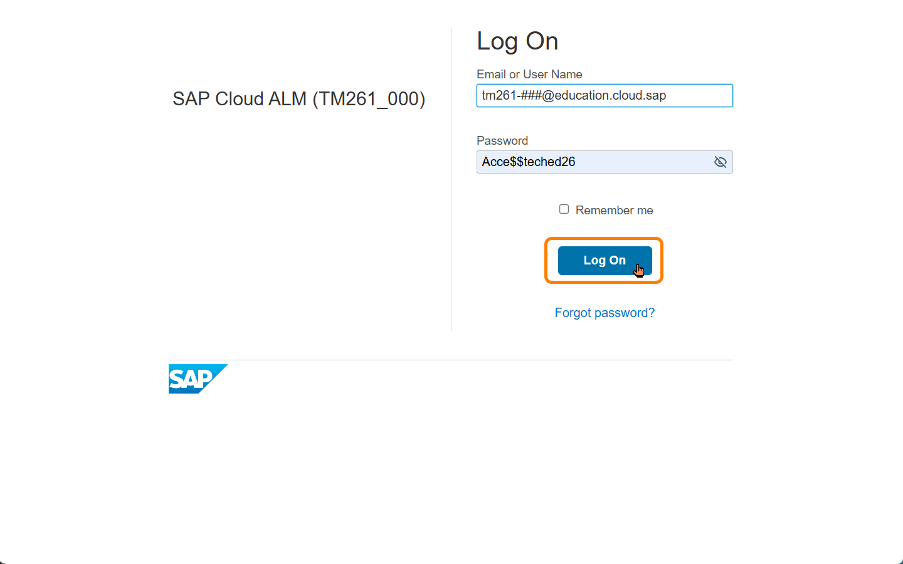

<em>01 – Login to SAP Cloud ALM</em>

---

## 1.2 – Open Joule

After logging in you land on the SAP Cloud ALM home page. Time to call your most valuable tool: **Joule**.

Joule is a chat-style AI interface built into SAP Cloud ALM. You'll use it throughout this session to interact with AI agents, ask questions, and drive the test preparation workflow; all in natural language.

**1.** Look for the **diamond icon** (◇) in the upper-right area of the screen and click it to open Joule.

 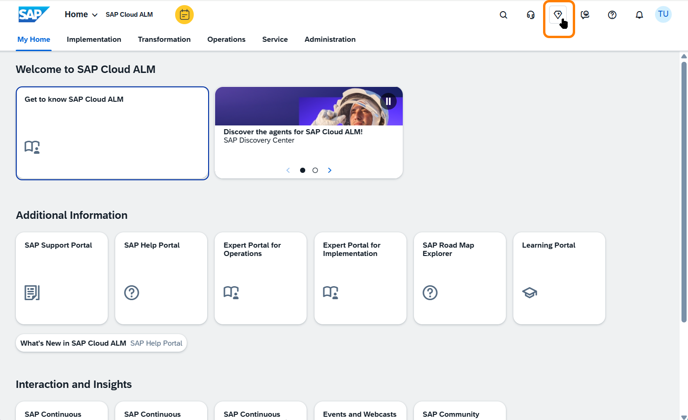

<em>02 – SAP Cloud ALM home page</em>

**2.** Joule opens as a panel that slides over the application screen; it's always available, regardless of where you are in SAP Cloud ALM.

The panel header gives you three controls:
- **Sidebar icon**: manage multiple concurrent conversations (you can run several Joule chats in parallel, e.g. one per topic or agent)
- **Expand icon**: open Joule in full-screen mode
- **Close (×)**: close the panel

> **Good to know:** Joule is stateful. Close the panel, navigate elsewhere, reopen it; your conversation is still there exactly as you left it.

 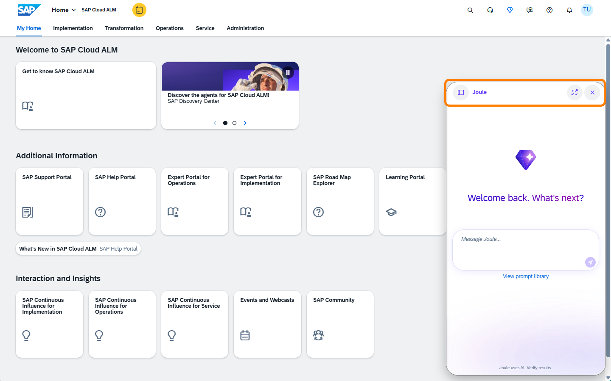

<em>03 – Joule panel open</em>

**3.** Wake up Joule with a simple message in the input box at the bottom; just type naturally, for example: **"Joule on :)"** or any greeting.

Joule responds with an introduction of its capabilities. Scroll through its response; you'll see areas like **Test Data Management**, **Test Scoping**, **Test Planning**, and **ALM Project Setup**. These are exactly the capabilities you'll use today.

 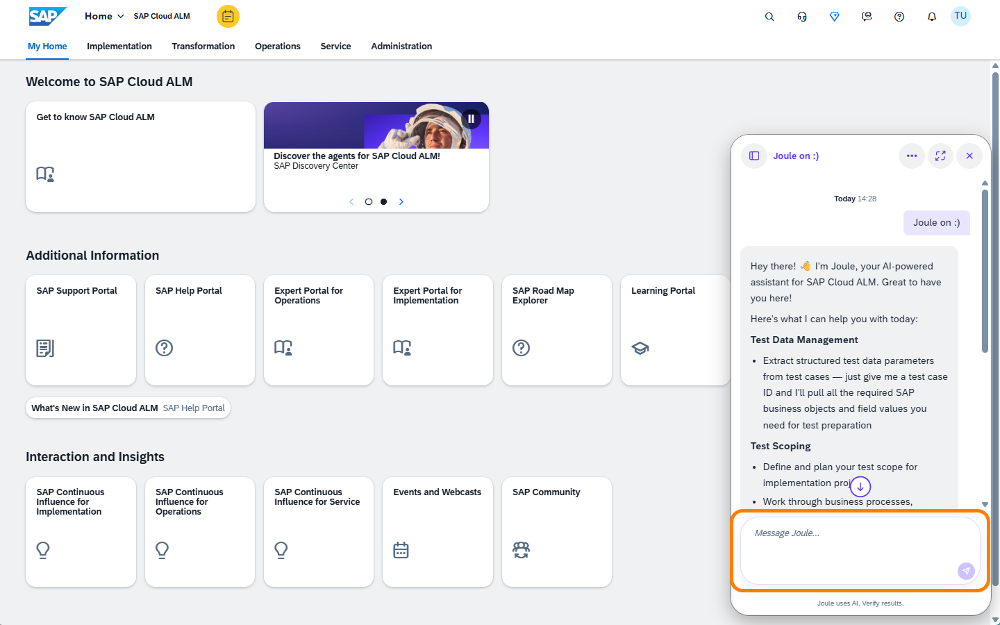

<em>04 – Joule greeting and capabilities</em>

---

## 1.3 – Jump Ahead: What Happens Without Preparation? *(Optional)*

> **Optional step**: try this if you want to see what happens when you skip straight to test case generation without proper setup.

Let's see what Joule does when asked to work with incomplete input.

In Joule, prompt it to generate test cases directly; specifying the process and project:

> *"I need to test process "Beta_Straight Make-to-Stock Production – Discrete Manufacturing (BJ5_simple)" in project "###_TestProject""*
>
> Replace **###** with your workstation number.

Joule navigates to the process in your project and analyses its content, but it hits a problem.

> **Tip:** Click the **expand icon** (⤢) in the Joule panel header to open Joule in full-screen mode: much easier to read Joule's responses, especially for longer agent outputs. The left sidebar shows your conversation list: up to **10 concurrent conversations** can be active at the same time, with older ones moved to **Expired**.

 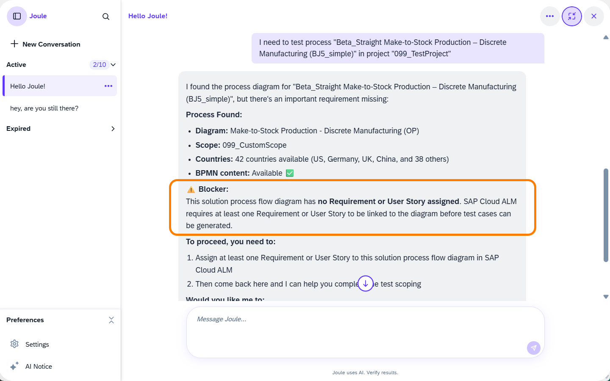

<em>05 – Joule blocked: no requirement or user story</em>

> **⚠️ Blocker: No Requirement or User Story Assigned**
>
> Joule found the process and confirmed the BPMN diagram is available, but it immediately flags a blocker: **no Requirement or User Story is linked to the process**. SAP Cloud ALM requires at least one to be assigned before test cases can be generated.
>
> This is intentional. **Garbage in, garbage out**: even for AI agents. The quality of the output depends directly on the quality of the input. Before Joule can do useful work, we need to enrich the process with requirements and user stories.
>
> That's exactly what we'll do in the next steps.

---

# Chapter 2 – Build Your Input

Before the AI agents can do useful work, the process needs to be populated with the documentation they'll work from: a BPMN diagram, user stories, and a requirements document. In this chapter you'll navigate to your project, assign pre-prepared user stories, and generate a requirements document from an expert interview transcript.

---

## 2.1 – Navigate to Your Project

Time to find our process. Close the Joule panel first (click **×** in the panel header), then navigate to the project.

**1.** Back on the home screen, click the **Implementation** tab in the top navigation bar. This is the launchpad for all test management related apps, and much more: requirements, process authoring, test preparation, test plans, test execution, defects.

 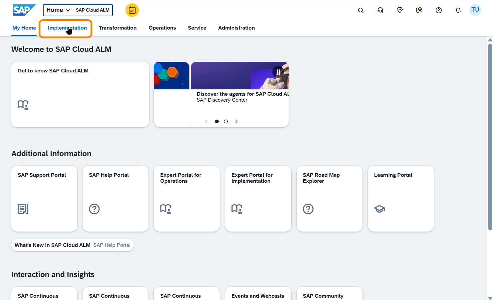

<em>06 – Implementation tab</em>

**2.** Under **Preparation and Setup**, click the **Projects and Setup** tile.

 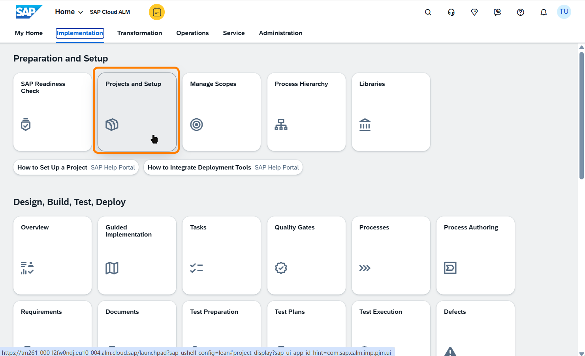

<em>07 – Projects and Setup tile</em>

**3.** In the **Manage Projects** list, locate your project: **`###_TestProject`** (replace ### with your workstation number). Click it to open the project details.

**4.** In the project detail view, click the **Scopes** tab. You'll see one scope: **`###_CustomScope`**: this is the container for all the process content you'll work with today. Click on it.

 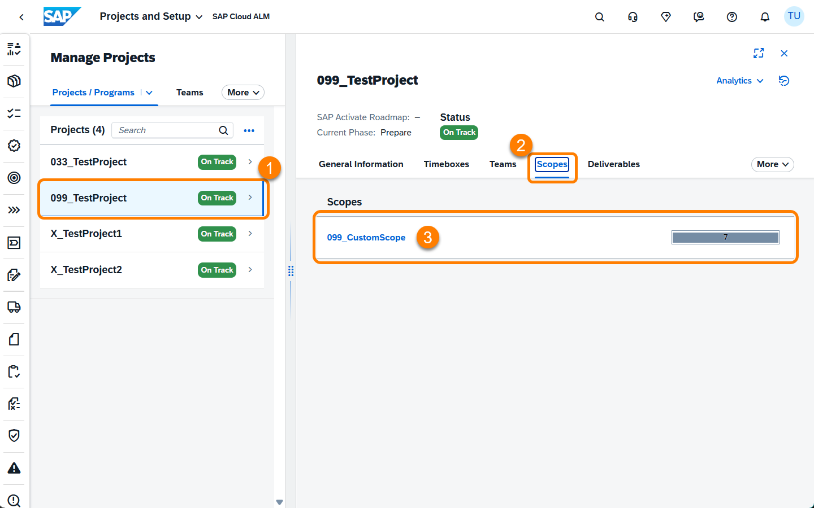

<em>08 – Project list and scope</em>

**5.** The view switches to **Open Solution Processes**, with the filter pre-set to your project and scope. You should see exactly one process: **`Beta_Straight Make-to-Stock Production – Discrete Manufacturing (BJ5_simple)`**: your process for today. Click on it to open its details.

 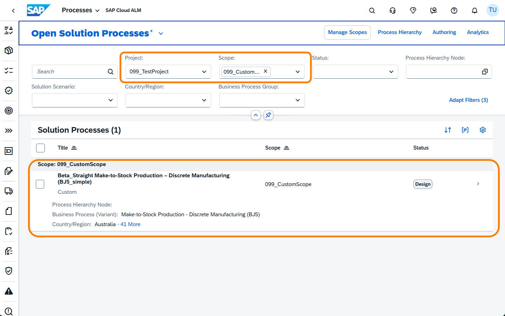

<em>09 – BJ5 process in the scope</em>

**6.** The process detail view opens. On the right-hand panel, next to the **General Information** and **Description** tabs, click **+8** to expand the full list of content types that can be linked to this process. Everything is at zero: no requirements, no user stories, no test cases. The process diagram on the left is also empty; no flows, no steps. This is your starting point.

 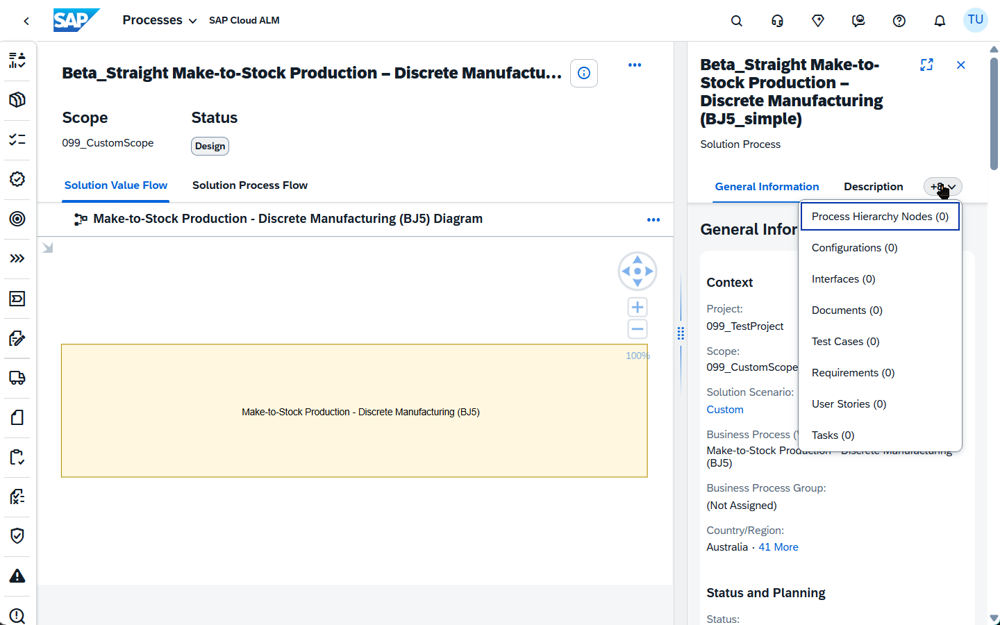

<em>10 – Process detail: all content at zero</em>

> **This is the root cause** of Joule's rejection in Step 1.3. With no requirements, no user stories, and no process content, there is nothing for the AI agents to work from. Before we can generate anything meaningful, we need to populate this process, and that's exactly what the next steps will do.

**7.** Now click the **Solution Process Flow** tab (next to Solution Value Flow). Here you'll find something more promising: a BPMN process diagram showing the BJ5 flow across two swimlanes; Production Planner and Warehouse Clerk.

This diagram was imported into SAP Cloud ALM from a process modeling tool such as **SAP Signavio**. It is natively stored here; a direct live integration with Signavio is planned as a future capability.

> **But here's the catch:** the diagram alone is not sufficient for the AI agents to generate high-quality scope, test plan, and test cases. It provides the process skeleton, but without requirements, user stories, and linked documentation, the agents can't derive meaningful test coverage from it.
>
> Feel free to explore the diagram. You can even make small changes, but don't alter it too dramatically, or the AI agents may flag inconsistencies between the diagram and the other content you'll add next.

 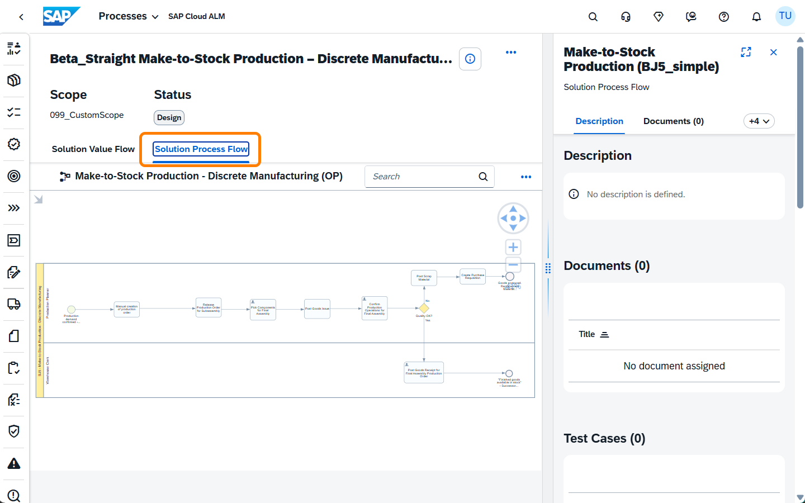

<em>11 – BJ5 process flow diagram</em>

> **In short:** A process structure exists and the diagram provides the skeleton. However, the process still lacks enriched content the AI agents need to do useful work. That's exactly what the next steps will fix.

---

## 2.2 – Assign User Stories

To give the AI agents enough to work with, we need to link supporting content to the process. Let's start with the user stories.

**1.** Make sure you are on the **Solution Value Flow** tab. On the right-hand panel, click **+8** to open the dropdown and select **User Stories**: this brings the User Stories section into view.

 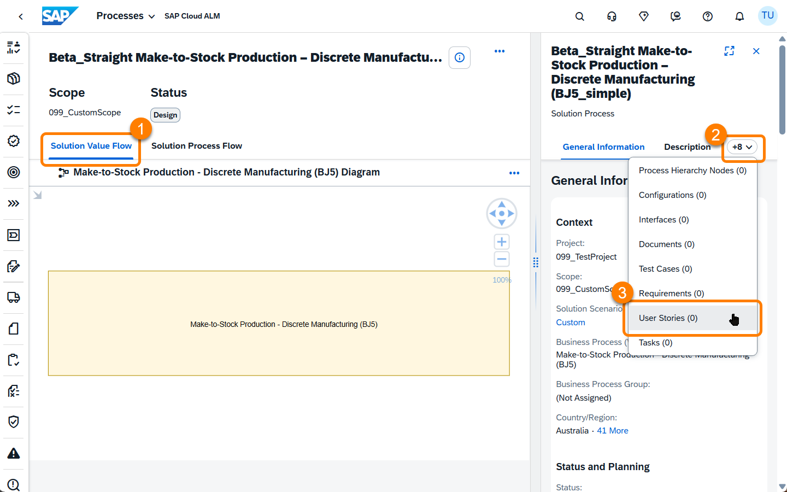

<em>12 – Opening User Stories section</em>

**2.** The **User Stories** section is now visible in the right panel: currently empty ("No user story assigned"). Click the **Assign** button to open the selection dialog. It comes pre-populated with user stories prepared for the BJ5 process.

 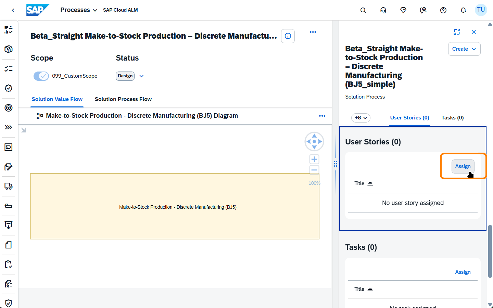

<em>13 – Assign User Stories dialog</em>

**3.** The **Assign User Stories** dialog opens. Scroll down to find the 7 BJ5 user stories (prefixed **BJ5_US-**) and select all of them:

| # | Story |
|---|---|
| 1 | Manual Creation of Production Order |
| 2 | Release Production Order |
| 3 | Pick Components and Post Goods Issue |
| 4 | Confirm Production Operations |
| 5 | Quality Assessment Gate |
| 6 | Post Goods Receipt – Finished Goods |
| 7 | Quality Failure Path: Scrap and Replenishment Request |

Once all 7 BJ5 stories are selected, click **Assign**.

 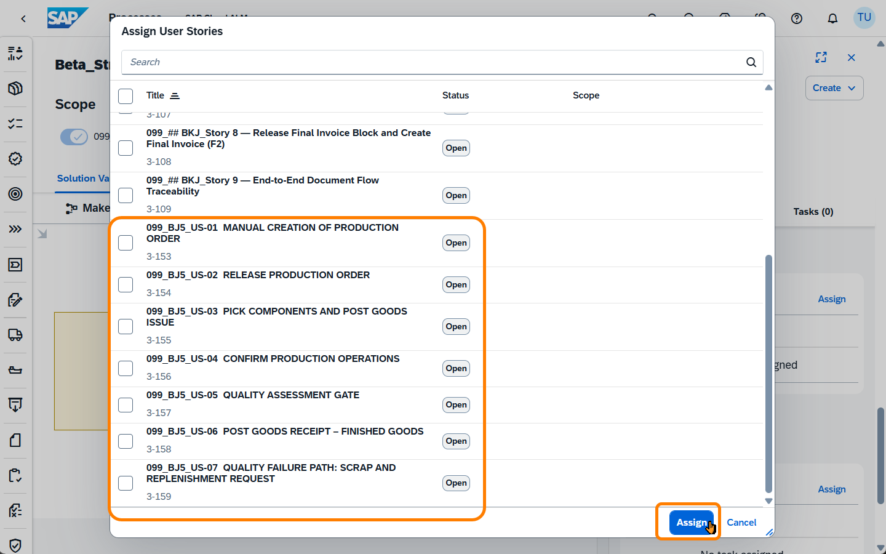

<em>14 – Selecting all 7 BJ5 user stories</em>

**4.** After returning to the process, feel free to open one of the user stories to inspect it. Each story is fully defined with **story points**, the **user story** narrative ("As an [role], I want to... so that..."), and granular **acceptance criteria**: exactly the kind of structured input the AI agents need.

 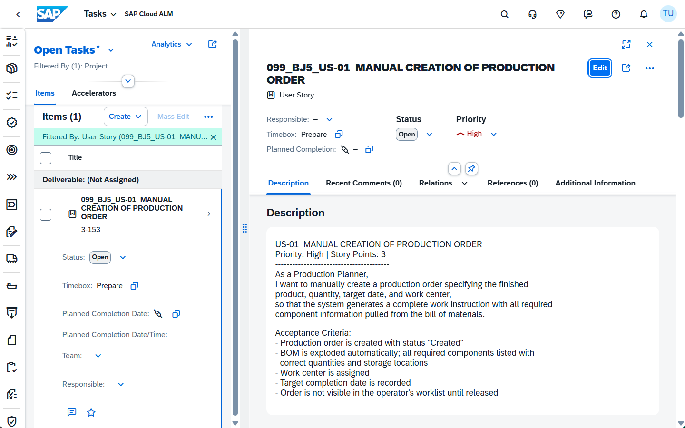

<em>15 – User story: narrative and acceptance criteria</em>

When done, click the **back arrow** (←) at the top left of the screen to return to the process view.

**5.** Back in the process, open the **+8** dropdown again; **User Stories** now shows **(7)**. The assignment worked.

But look at **Requirements (0)**. That entry is still empty, and it's arguably the most important input for the AI agents. A well-formed requirements document gives the agents the business rules, constraints, and acceptance detail they need to generate meaningful test coverage.

Here's the good news: you were recently in a structured interview with a BJ5 process expert, walking through the process step by step in detail. Your colleague promised to post the transcript in SAP Cloud ALM for further use. Time to retrieve it and turn it into a requirements document.

 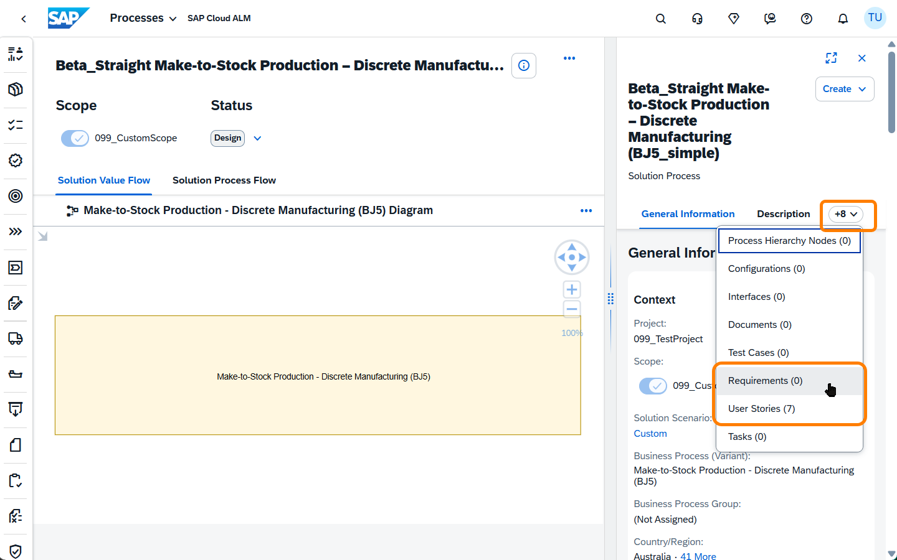

<em>16 – Requirements count still zero</em>

---

## Summary

Chapters 1 and 2 (so far):
- [x] Logged in and opened Joule
- [x] BJ5 process located in `###_TestProject / ###_CustomScope`
- [x] 7 BJ5 user stories assigned to the process
- [ ] Requirements document: still missing; covered in step 2.3

Continue to [Chapter 2 – Build Your Input (continued)](../ex1/README.md)
