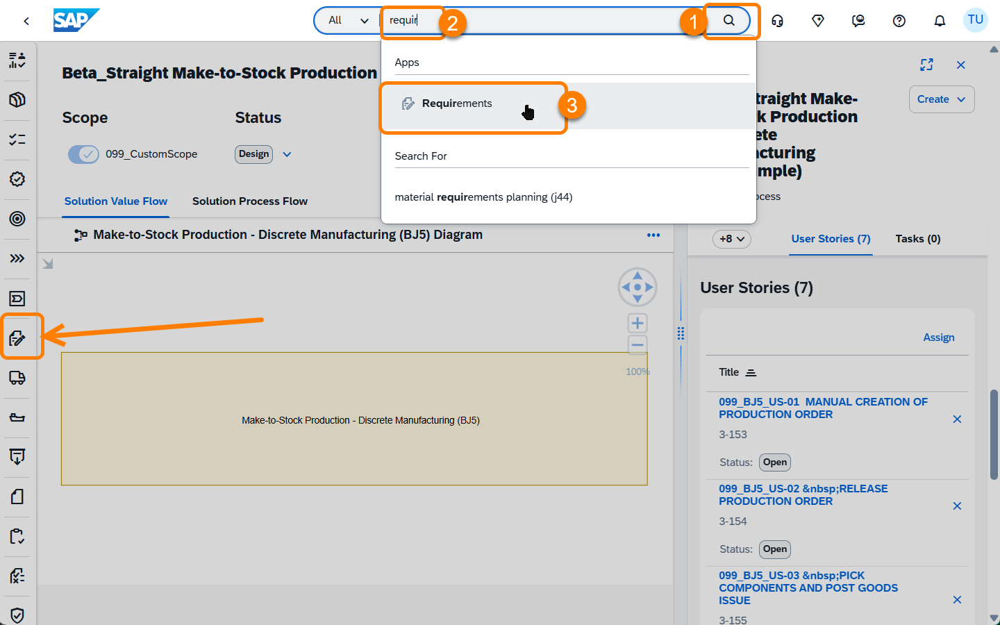
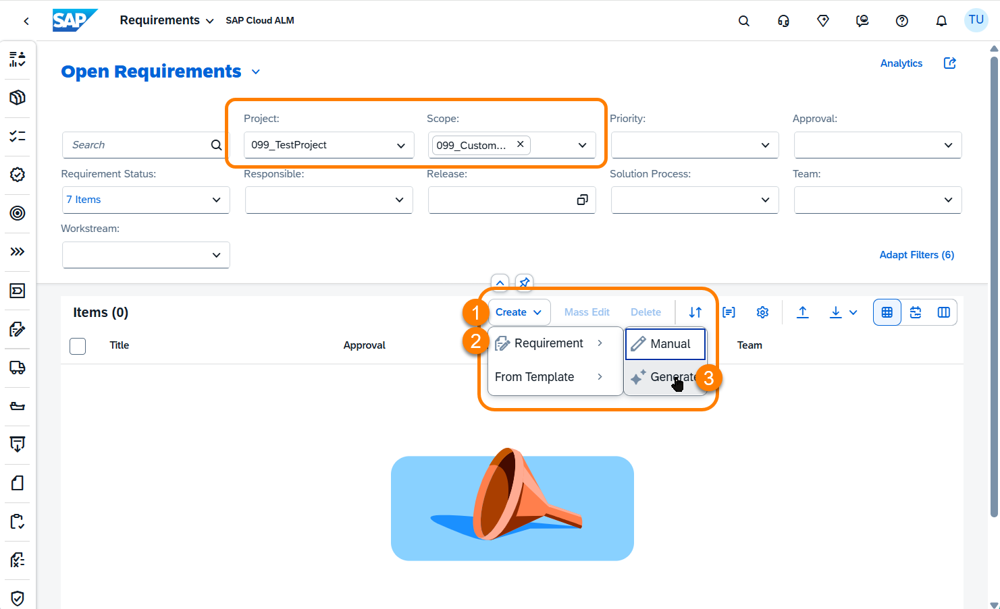
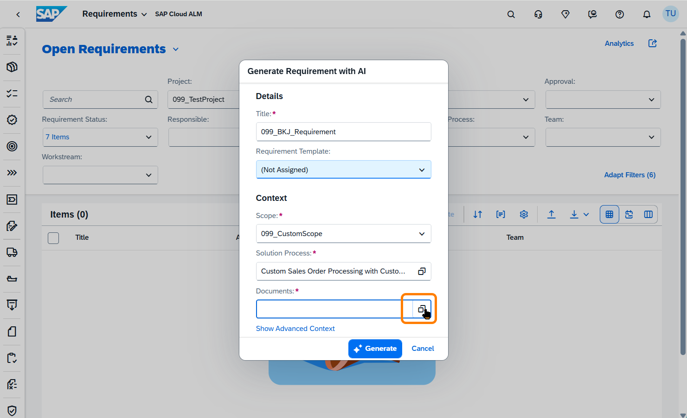
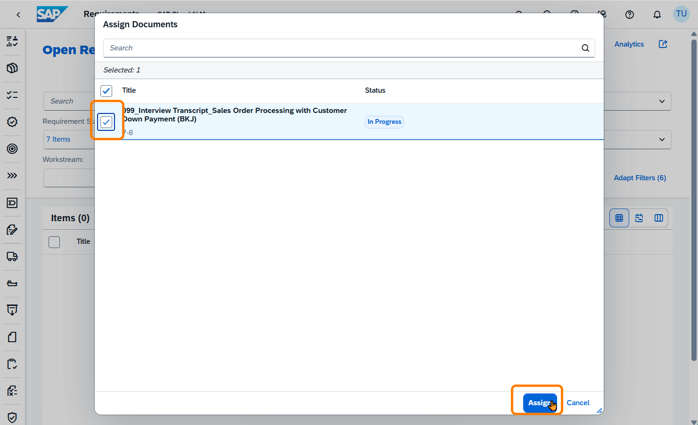
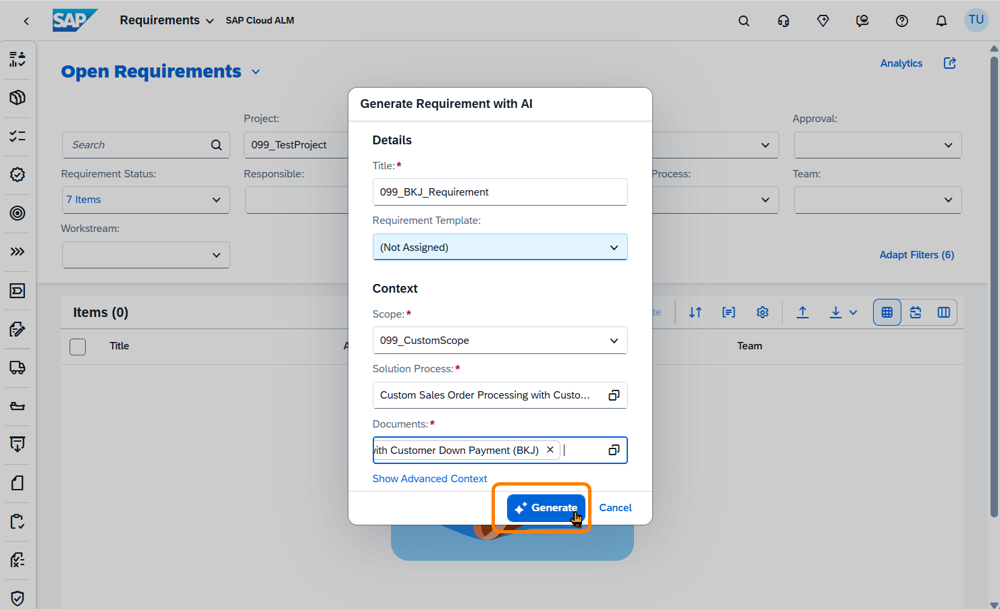
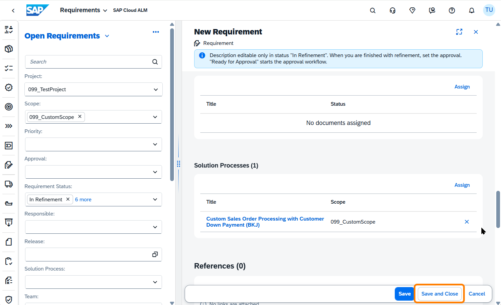

<!-- Chapter 2 – Feed the Agents, continued from exercises/ex0/README.md -->

## 2.3 – Generate Requirements from an Interview Transcript

**Prerequisite:** You have completed [Chapter 2 – steps 2.1 and 2.2](../ex0/README.md); the BJ5 process is set up with *User Stories*.

---

## What You'll Do

In this step you'll use the *Requirements* app to generate a *Requirements* document from an interview transcript. A BJ5 process expert was interviewed and the recording transcribed; the transcript is waiting for you in the system. The AI will read through it and extract the key business rules, process steps, and constraints into a structured *Requirements* document, automatically.

---

**1.** Navigate to the **Requirements** app. There are two ways:

- **Search bar** (top center): type `requir` and select **Requirements** from the quick results
- **Left toolbar**: click the quick-link icon that looks like a document being written on with a pen

 

<em>18 – Requirements app</em>

The *Requirements* app opens with filters pre-set to your project and scope; confirm both show your workstation number (`###_TestProject` / `###_CustomScope`). The list is empty: no *Requirements* exist yet.

Click **Create**, then hover over **Requirement**: a sub-menu appears with two options. Select **Generate** to have AI build the *Requirement* from a source document rather than writing it manually.

 

<em>19 – Create → Generate menu</em>

**2.** The **Generate Requirement with AI** dialog opens. Fill in the fields:

| Field | Value |
|---|---|
| **Title** | `###_BJ5_Requirement` (replace ### with your workstation number, e.g. `018`, `033`) |
| **Requirement Template** | (Not Assigned) |
| **Scope** | `###_CustomScope` |
| **Solution Process** | Beta_Straight Make-to-Stock Production – Discrete Manufacturing (BJ5_simple) |
| **Documents** | ← click the selection icon to open the document picker |

In the **Documents** field, click the **selection icon** to choose the source document.

 

<em>20 – Generate Requirement with AI dialog</em>

The **Assign Documents** dialog opens. You should see exactly one document: a transcript of a ~20-minute interview with a BJ5 process expert, covering process steps, role responsibilities, and business rules. Select it and click **Assign**.

 

<em>21 – Selecting the interview transcript</em>

**3.** Back in the **Generate Requirement with AI** dialog, the transcript now appears in the **Documents** field. Everything is set. Click **Generate**.

SAP Cloud ALM's built-in AI agent reads the full conversation transcript and converts it into a structured *Requirements* document, automatically. You'll be able to review the result in the next screen.

 

<em>22 – Triggering AI generation</em>

**4.** The AI has created the new *Requirement*. The detail view opens automatically.

A few things worth noting here:

- Review the generated **description**: this is the structured *Requirements* content extracted from the interview transcript.
- The info banner at the top reminds you that the description is editable while the status is *In Refinement*. Feel free to make adjustments if needed.
- In the left panel, **scroll down** to the **Solution Processes** section: the *BJ5_simple* process has been **automatically linked**, no manual assignment needed.
- At the bottom you can optionally fill in approver, priority, and other fields; skip this for now.

When satisfied, click **Save and Close**.

 

<em>23 – Generated requirement: detail view</em>

---

## Summary

Chapter 2 complete. The process now has everything the AI agents need:
- [x] BPMN process diagram (from Signavio)
- [x] 7 *User Stories* (assigned in Step 2.2)
- [x] *Requirements* document (generated in Step 2.3)

A 20-minute expert interview was converted into a structured *Requirements* document, automatically linked to the BJ5 process. Time to head back to Joule and try what failed in Step 1.3; this time with proper input in place.

Continue to [Chapter 3 – Scope with AI](../ex2/README.md)
