# TM261 – Agent-Led Test Management: Hands-on Lab with Joule in SAP Cloud ALM

**Cloud ALM Summit 2026**  
**Presenters:** SAP Cloud ALM Product Ownership:  
Christina Pickhardt · Daniel Lorenz · Niclas Weidner · Tobias Keller · Tobias Meinzer

← Back to [start](../../README.md)

# Introduction

Log in, fire the first AI agent, get the session introduction while it runs, then tour the project structures it is working from.

| # | Chapter | Topic |
|---|---|---|
| – | **Introduction** *(this page)* | Log in · trigger Scoping Agent · TMA overview · project structure walkthrough |
| 3 | [Scope with AI](../ex2/README.md) | Scoping agent result; refine through conversation |
| 4 | [Plan with AI](../ex3/README.md) | Planning agent; HITL gate; review test plan |
| 5 | [Generate Test Cases](../ex4/README.md) | TC generation agent; quality review |
| 6 | [Generate Test Data](../ex5/README.md) | Data agent; classify parameters; explore dependencies |
| 7 | [Recap & Outlook](../ex6/README.md) | Time saved; roadmap; key takeaways |

---

This is the express entry point for this session. The following are already configured for your workstation — you're joining the workflow at the point where the AI agents take over:

| Pre-configured | Detail |
|---|---|
| BPMN process diagram | BJ5_simple — an illustrative process variant based on SAP S/4HANA Scope Item BJ5, importable e.g. from SAP Signavio |
| 7 *User Stories* | BJ5_US-01 – BJ5_US-07, linked to the process |
| *Requirements* document | Generated from a BJ5 expert interview transcript |

Log in, open Joule, and you're ready to trigger the first agent.

---

## 1 – Log In & First Agent Call

### Log In to SAP Cloud ALM

SAP Cloud ALM Test Management is where this session happens: the platform where you plan, execute, and track test projects end to end, with every test artifact traceable back to *Requirements*.

Open your browser and navigate to the Cloud ALM tenant.

> **Your credentials:**
>
> | Field | Value |
> |---|---|
> | **Tenant** | [SAP Cloud ALM (TM261)](https://tm261-000-l2fw0ndj.eu10-004.alm.cloud.sap/launchpad) |
> | **User** | `tm261-###@education.cloud.sap` |
> | **Password** | `Acce$$teched26` |
>
> Replace **###** with your workspace number, zero-padded to three digits: space 3 → `003`, space 18 → `018`, space 42 → `042`. Your workspace number is on the card on your desk (or you received it at the entrance).
>
> Whenever you see `###` in a field value, filename, or prompt in this guide, that's your cue to substitute your own number.


**1.** Enter your username and password, then click **Log On**.

<br>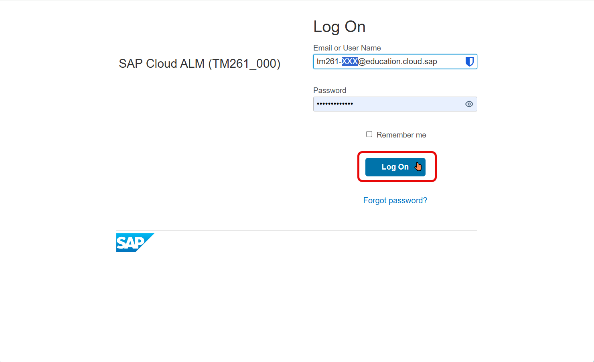
<p style="font-size:9pt;color:#888;margin-top:-0.5em"><em>01 – Login to SAP Cloud ALM</em></p>

### Open Joule

After logging in you land on the SAP Cloud ALM home page. Let's open your most important tool for today: **Joule**.

Joule is a chat-style AI interface built into SAP Cloud ALM. You'll use it throughout this session to interact with AI agents, ask questions, and drive the Test Preparation workflow — all in natural language.

**1.** Look for the **diamond icon** in the upper-right area of the screen and click it to open Joule.

<br>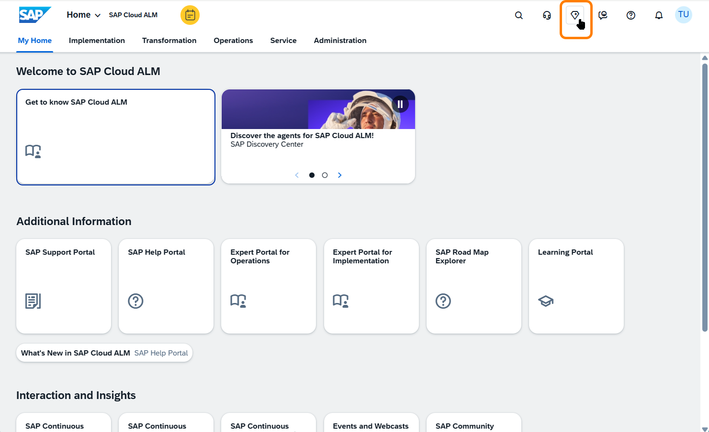
<p style="font-size:9pt;color:#888;margin-top:-0.5em"><em>02 – SAP Cloud ALM home page</em></p>

**2.** Joule opens as a panel that slides over the application screen; it's always available, regardless of where you are in SAP Cloud ALM.

The panel header gives you three controls:
- **Expand icon**: open Joule in full-screen mode
- **Close (×)**: close the panel
- **Sidebar icon**: manage multiple concurrent conversations (you can run several Joule chats in parallel, one per topic or agent)

> **Good to know:** Joule is stateful. Close the panel, navigate elsewhere, reopen it; your conversation is still there where you left it.
> The sidebar shows your conversation list: up to **10 conversations can be active** at the same time, with older ones moved to **Expired**.

<br>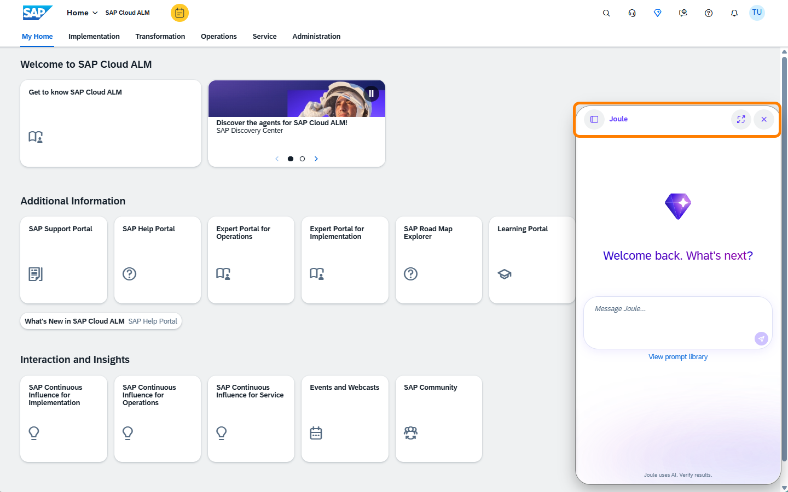
<p style="font-size:9pt;color:#888;margin-top:-0.5em"><em>03 – Joule panel open</em></p>

**3.** Wake up Joule with a simple message in the input box at the bottom; just type naturally, for example: **"Joule on :)"** or any greeting.

> ⚠ **Before you continue: a word on stability.** The agentic capabilities you're about to use involve complex multi-step orchestration across multiple AI skills and agent calls. This session runs on a shared productive tenant; expect some variability in response times.
>
> If Joule appears frozen, read ahead and give it a moment. If it seems to have timed out or lost context entirely, send a gentle follow-up ("still there?" or "hi") to wake it up, or re-send the original prompt.

Joule will start processing; this can take a moment. When it responds, you'll see an introduction of its capabilities covering areas like **Test Data Management**, **Test Scoping**, **Test Planning**, and **ALM Project Setup**. These are exactly the capabilities you'll use today.

<br>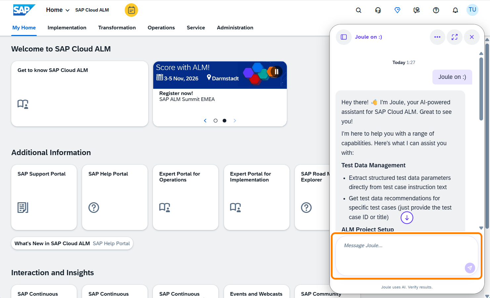
<p style="font-size:9pt;color:#888;margin-top:-0.5em"><em>04 – Joule greeting and capabilities</em></p>

### Trigger the Scoping Agent

Your process is ready: *Requirements*, *User Stories*, and the BPMN diagram are all linked and in place. Let's put that to work.

**1.** Open a **new conversation** in Joule: click the **sidebar icon** in the panel header, then select **New Conversation**.

**2.** Send the following prompt — replace `###` with your workstation number:

```
I need to test process "Beta_Straight Make-to-Stock Production – Discrete Manufacturing (BJ5_simple)" in project "###_TestProject"
```

**3.** Joule picks up the request and the scoping agent starts working in the background. You will see a progress indicator in the panel.

> ⏱ **This takes 10–15 minutes.** The agent is reading the linked *Requirements*, *User Stories*, and process diagram and building a structured test scope. We'll use that time for the session introduction — come back to Joule afterwards.

---

## 2 – Introduction: Test Management Assistant

### Context: SAP Migration & Modernization Assistants

Before we jump into the hands-on, a quick word on context, because what you're about to use is not an isolated feature.

SAP has developed seven AI-powered assistants for Migration and Modernization scenarios, built to help customers move from SAP ECC to S/4HANA Cloud Private Edition faster and with significantly less manual effort:

<br>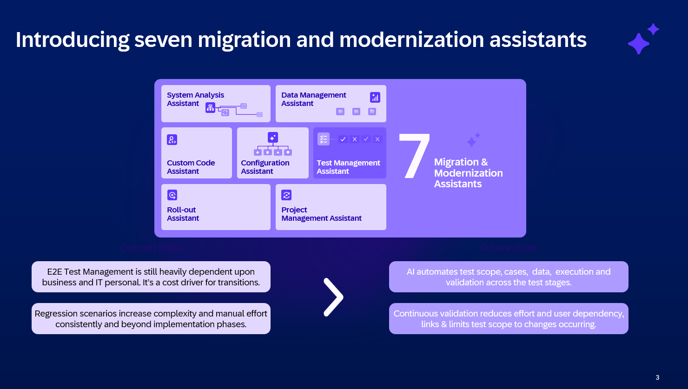
<p style="font-size:9pt;color:#888;margin-top:-0.5em"><em>05 – Seven SAP Migration &amp; Modernization Assistants</em></p>

The **Test Management Assistant** is one of these seven, and Test Management is an area where the shift from manual to AI-driven work matters most:

End-to-end test management for SAP migrations and modernizations is still heavily dependent on business and IT personnel. It is a consistent cost driver across transition projects, and complexity grows with every regression cycle: more scenarios, more variants, more manual effort.

The Test Management Assistant targets the upstream side of this: the preparation of manual end-to-end testing. It applies AI to test scoping, test case writing, and test data preparation; these are the stages where expert effort is highest and where days of work can be compressed into minutes of guided review.

Test execution itself is outside the current scope of the assistant. That stage is covered by the partner ecosystem: Tricentis, SAP's strategic partner for test automation, provides execution capabilities that complement the AI-driven preparation in SAP Cloud ALM.

### What is the Test Management Assistant?

The Test Management Assistant is not a single AI feature; it's a pipeline of four specialized agents, each transforming a stage of manual Test Preparation into an AI-driven capability:

<br>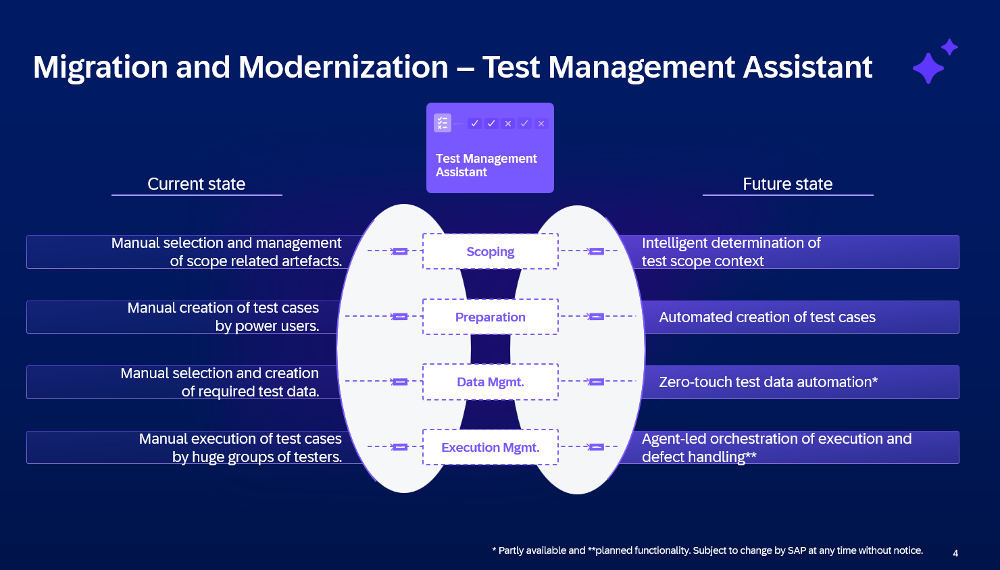
<p style="font-size:9pt;color:#888;margin-top:-0.5em"><em>06 – Test Management Assistant: four-agent pipeline</em></p>

The Scoping, Preparation, and Test Data Management agents (Phase 1\*) have been released and are currently in Early Adopter Care with selected customers. GA is targeted before the end of this year. The Test Execution Quality Management agent is planned for 2027\*\*.

> *\* Partly available; \*\*planned functionality. Subject to change by SAP at any time without notice.*

> **Today's hands-on covers the three agents available today**: Scoping, Preparation, and Data Management. Execution Management is on the roadmap.

---

## 3 – What the Agent Is Working From

While the agent runs, let's look at the Cloud ALM structures it is consuming.

**1.** Go back to the Cloud ALM home page. Select the **Implementation** tab in the top navigation bar — this is where Cloud ALM Test Management lives alongside the other implementation tools.

In the **Preparation and Setup** section, click the **Projects and Setup** tile.

<br>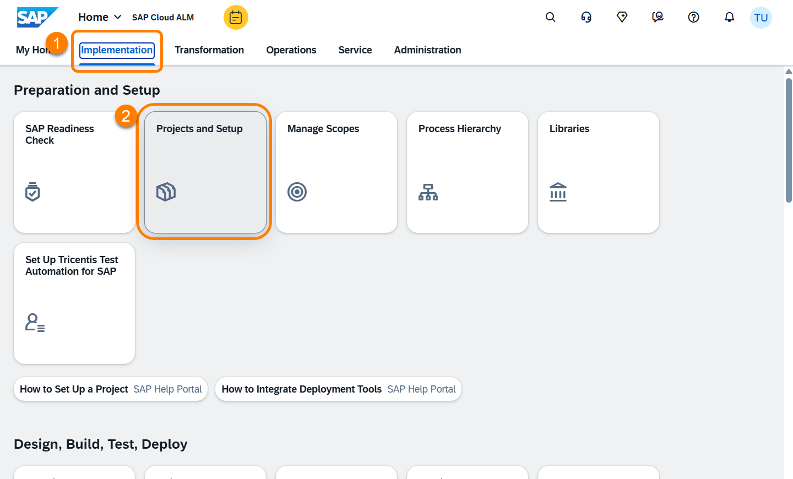
<p style="font-size:9pt;color:#888;margin-top:-0.5em"><em>05 – Implementation tab and Projects and Setup tile</em></p>

**2.** In the **Manage Projects** list:
1. Search for your workstation number
2. Select your project (`###_TestProject`)
3. In the project details, open the **Scopes** tab
4. Click on `###_CustomScope`

<br>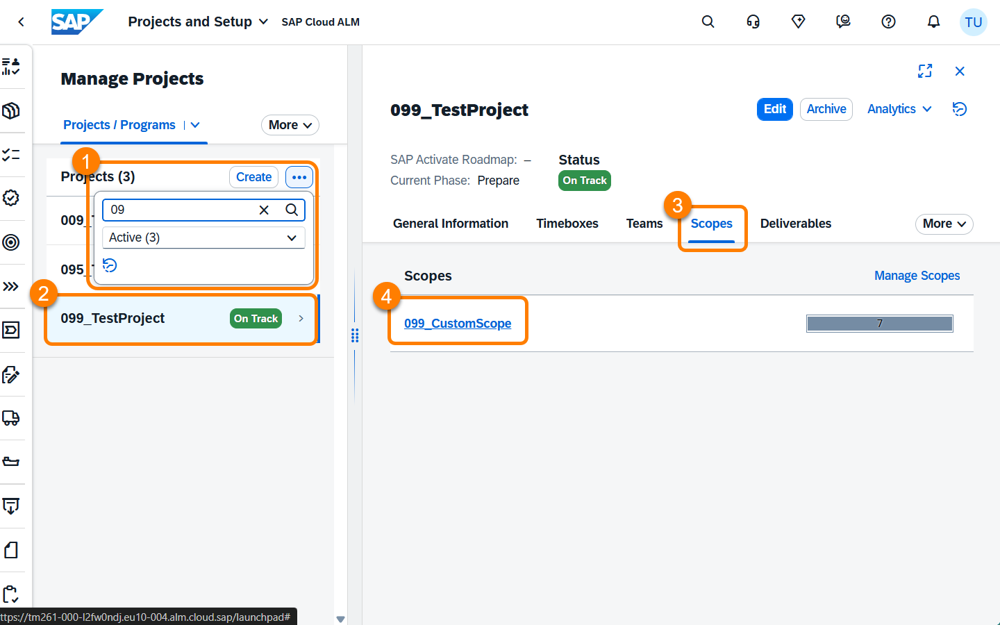
<p style="font-size:9pt;color:#888;margin-top:-0.5em"><em>06 – Locating your project and scope</em></p>

**3.** Inside the scope you'll see the process **Beta_Straight Make-to-Stock Production – Discrete Manufacturing (BJ5_simple)**. Click on it to open its details.

<br>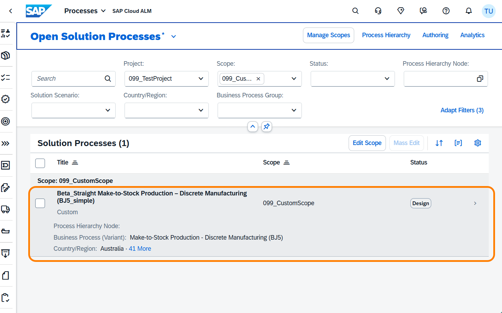
<p style="font-size:9pt;color:#888;margin-top:-0.5em"><em>07 – BJ5_simple process inside the custom scope</em></p>

**4.** In the process detail view, click the **Solution Process Flow** tab. You'll find the BPMN diagram of the BJ5_simple process — two swimlanes showing the Production Planner and Warehouse Clerk roles and the steps between them, including the quality gate decision. This is one of the inputs the scoping agent uses to understand the process structure.

<br>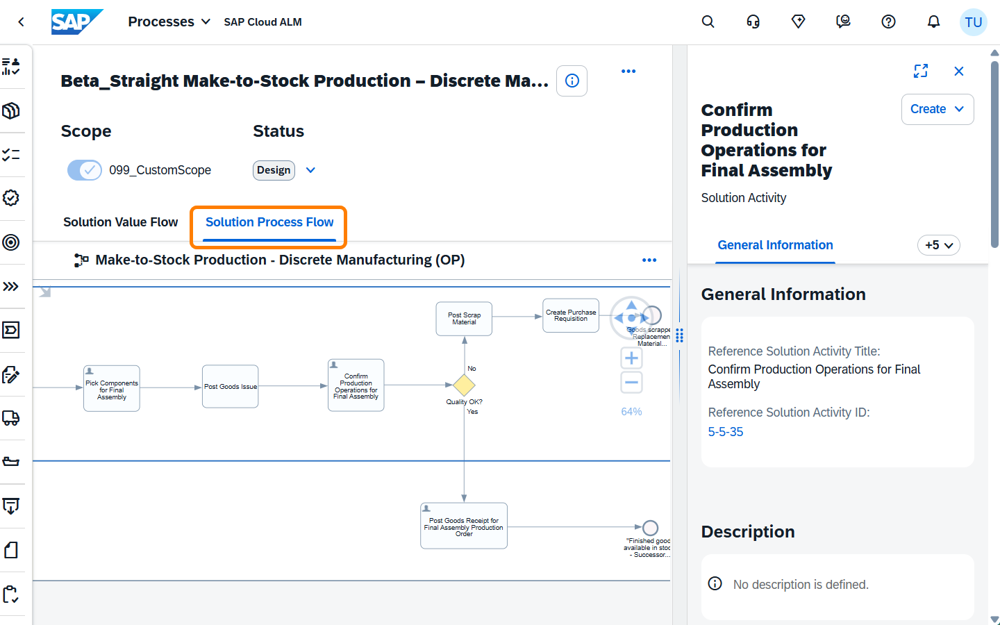
<p style="font-size:9pt;color:#888;margin-top:-0.5em"><em>08 – Solution Process Flow: BJ5_simple BPMN diagram</em></p>

**5.** Switch back to the **Solution Value Flow** tab (1). On the right-hand panel, click the **"+9"** button (2) — this expands the full list of content types that can be linked to a process. Notice the counts: **Requirements (1)** and **User Stories (7)** are already in place (3). These are exactly the inputs the scoping agent is working from right now.

<br>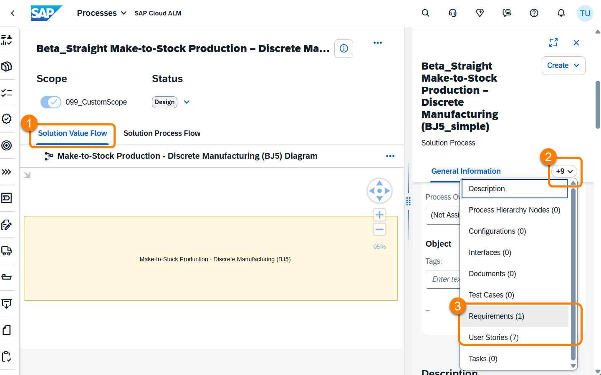
<p style="font-size:9pt;color:#888;margin-top:-0.5em"><em>09 – Solution Value Flow: Requirements and User Stories linked</em></p>

**6.** Click on **Requirements** in the list to expand that section, then open the linked requirement to read through it. Do the same for one of the **User Stories** — each entry shows as a card with an **Open** button.

<br>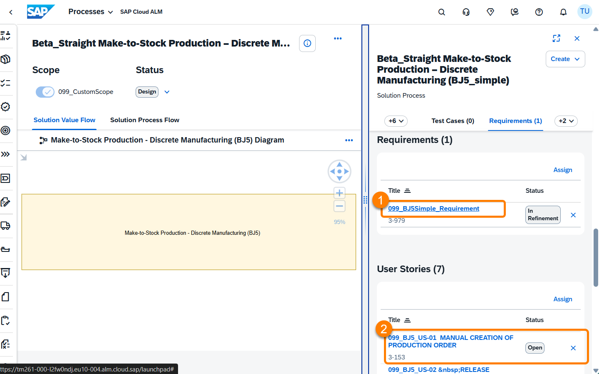
<p style="font-size:9pt;color:#888;margin-top:-0.5em"><em>10 – A linked User Story: structured input for the agent</em></p>

This is the raw material the scoping agent has been reading while you were here. The *Requirements* document captures the business rules and process intent extracted from the expert interview; the *User Stories* add the acceptance criteria per role and scenario. Together with the BPMN diagram, these three inputs are what the agent uses to build a traceable test scope — without any of them, it would have blocked and asked you to add them first.

With that you have an overview of the information the scoping agent currently is able to draw on. Remember: the more — and higher-quality — information the agents get, the better the outcome.

---

Continue to [Chapter 3 – Scope with AI →](../ex2/README.md#32--whats-happening-in-the-background)
