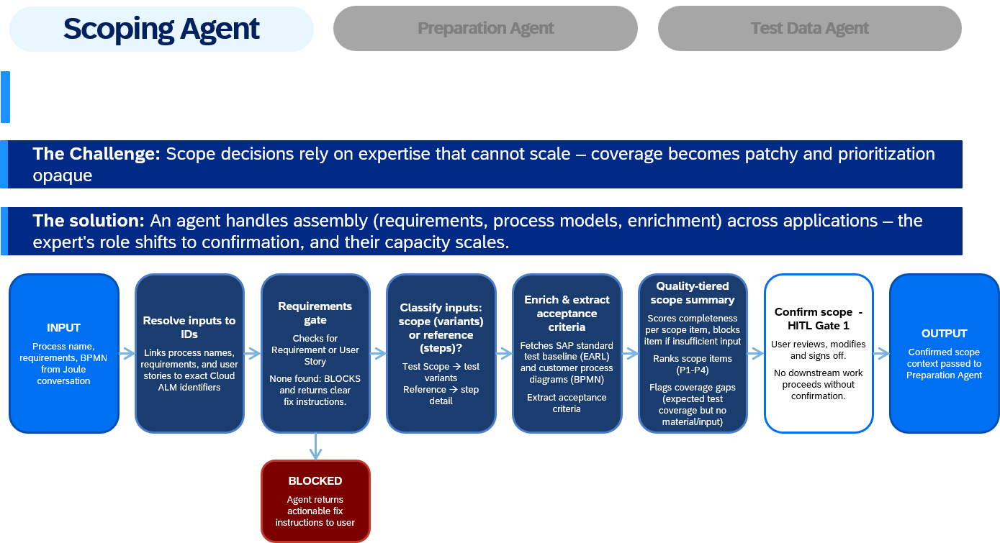
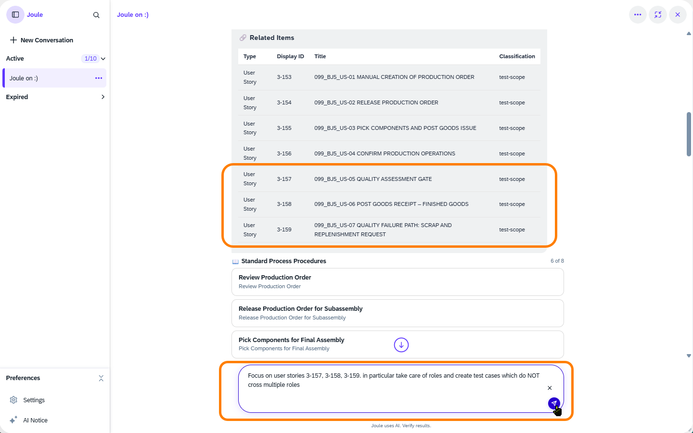

# Chapter 3 – Scope with AI

**Prerequisite:** You have completed [Chapter 2](../ex1/README.md); the *BJ5_simple* process has linked *Requirements* and *User Stories*.

---

## What You'll Do

In this chapter you'll trigger the **Scoping Agent**: an AI agent that reads your linked process documentation and proposes a structured *Test Case* scope. While it works in the background, you'll run a quick manual scoping exercise; when the result arrives, you can see exactly what the AI found versus what you identified.

---

## 3.1 – Trigger the Scoping Agent

Time to try again; with proper input now in place.

**1.** Open a new conversation in Joule and send the **same prompt** as in Step 1.3:

> *"I need to test process "Beta_Straight Make-to-Stock Production – Discrete Manufacturing (BJ5_simple)" in project "###_TestProject""*
>
> Replace **###** with your workstation number.

**2.** The scoping agent starts working in the background. You'll see a notification or progress indicator.

 

<em>24 – Scoping agent running</em>

---

## 3.2 – What's happening in the background?

 

<em>25 – Scoping agent methodology</em>

> **The scoping agent applies a structured methodology:**
> 1. It resolves the process name, *Requirements*, and *User Stories* to exact identifiers in SAP Cloud ALM
> 2. It validates that the required input exists; if not, it blocks and returns clear instructions on what to fix
> 3. It classifies each input: process scope variants or detailed reference steps
> 4. It enriches the scope with SAP standard test baselines and extracts Acceptance Criteria from your linked content
> 5. It scores each *Scope Item* for completeness, ranks items by priority, and flags coverage gaps
> 6. It presents the result for your review and sign-off; no downstream work starts without your approval (the "Human in the Loop", or HITL, Gate 1)
>
> This is the same analysis a skilled test architect would do, but compressed from hours into minutes.

---

## 3.3 – Manual Scoping Exercise

While you wait for the agent, try a structured manual scoping exercise.

Return to the Processes app and for the *BJ5_simple* process, think through these dimensions (a piece of paper to jot notes works fine):

| Dimension | Your Answer |
|---|---|
| What are the main **process paths** (happy path + variants)? | |
| What **acceptance criteria** can you identify from the *User Stories* and *Requirements*? | |
| How many distinct **apps/UIs** are involved? | |
| How many **roles** participate? | |
| Which steps have **blocking conditions** worth testing? | |
| What **error scenarios** can you imagine that should be covered? | |

> Hint: The BJ5 process involves 2 roles (Production Planner and Warehouse Clerk) and spans the full make-to-stock cycle from production order creation to finished goods receipt. There is 1 critical quality gate where output is assessed before goods receipt, and a separate failure path for scrap and replenishment.

---

## 3.4 – Review the Scoping Agent's Work

**1.** When the agent is ready, it replies directly in the Joule chat window with a **Test Scope Summary**. The response is detailed; best switch Joule to **full-screen mode** first using the **expand icon** in the top-right of the Joule panel.

The response typically gives you:

- **Process context**: the *Solution Process*, flow diagram, and applicable countries it resolved
- A **summary of identified process flow paths**, reflecting any splits or variants in the process structure
- An overview of the **items it ingested** (your *Requirement* and the 7 *User Stories*)
- Related **standard process procedures** retrieved from the SAP Enterprise Architecture Reference Library (EARL)
- A conclusive list of **acceptance criteria** derived from all of the above, augmented with patterns from SAP's standard process baselines

 

<em>26 – Test Scope Summary in Joule</em>

After the response, the agent asks you whether to confirm the scope as is or revise it.

> **HITL (Human in the Loop) Gate 1: Test Scope Summary.** This is the first checkpoint in Test Management Assistant's agentic workflow. The agent stops, presents its detailed structured analysis, and waits for your review and sign-off. Nothing proceeds until you confirm.

**2.** Before making that decision, take a few minutes to work through the proposed scope. For each item, check:
- **Name and description**: does it clearly describe what's being tested?
- **Linked acceptance criteria**: is it traceable back to a *User Story* or *Requirement*?
- **Role separation**: are Production Planner tasks and Warehouse Clerk tasks kept in separate *Test Cases*?
- **Coverage**: does the overall set cover the happy path (P1), the quality gate failure path (P2), and the scrap/replenishment scenario?

> **Compare with your manual notes from Step 3.3:** Did the agent catch everything you identified? Or did it find things you missed? That's exactly the kind of task AI agents excel at: ingesting text, inferring structure, and surfacing patterns at speed.

---

## 3.5 – Refine the Scope in Joule

Let's not just accept the scope as is. Joule lets you refine it through conversation, and this is the moment to apply your focus on role switches and shape the scope accordingly.

> **Note for participants sharing a system:** In a real-life scenario you'd typically start with the full E2E process before narrowing down. The reason for this tweak is twofold: first, it lets you experience how to shape agent output through a simple conversation; and second, the agents run on shared infrastructure and we want to avoid overloading the system with heavy concurrent calls. So we recommend limiting the scope to **user stories 5, 6, and 7** (the quality gate, goods receipt, and failure path), where the handoff from Production Planner to Warehouse Clerk happens.

Two options are available; as you'll see, the second is the more direct one.

**Option 1: Use the built-in "Revise Scope" shortcut**

Click the **Select** button in the Joule output panel, then choose **Revise Scope** from the dropdown. This sends a built-in prompt ("No, let me revise the scope" or similar) to the agent, which then asks you what you'd like to change. You'd still need to type your refinement in the follow-up message, making it identical to Option 2 but with one extra round-trip.

**Option 2: Write your own prompt**

You can also type your refinement directly in the Joule chat window. Navigate to *User Stories* US-05, US-06, and US-07 and note their Display IDs (format: `3-xxx`), then use a prompt like:

> "Focus on *User Stories* **[enter the Display IDs]**. In particular take care of roles and create *Test Cases* which do NOT cross multiple roles."

 

<em>27 – Refinement prompt: focusing on three user stories</em>

You may try other refinements too:
- **Narrow the scope:** "Remove *User Stories* 1–4 from the scope for now; focus only on the quality gate, goods receipt, and scrap path."
- **Narrow by role:** "Drop the Production Planner for now, and consider only the process steps relevant for the Warehouse Clerk."

The agent re-runs its scoping logic and returns faster than the first pass. It presents the revised scope and pauses for your sign-off again. This time, click **Confirm** to accept the scope and move to the next stage.

---

## Summary

The scoping agent analyzed all your linked process artifacts and proposed a structured *Test Case* scope, with traceability to *Requirements* and *User Stories*, in the time it took you to sketch a rough outline manually.

You now have a **confirmed test case scope** that moves automatically into test planning.

Continue to [Chapter 4 – Plan with AI](../ex3/README.md)
