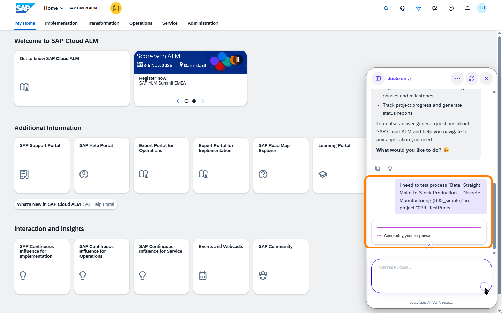
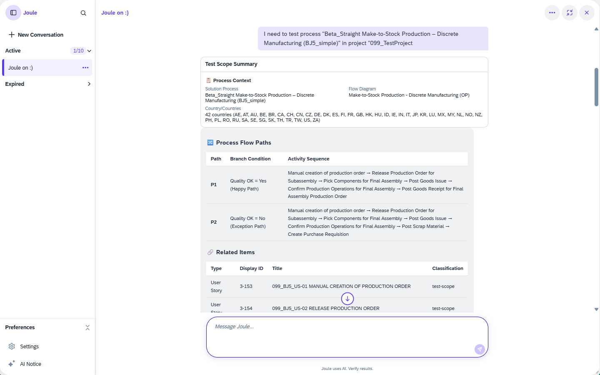

# Exercise 2 – Scope Your Tests with AI

**Prerequisite:** You have completed [Exercise 1](../ex1/README.md); the BKJ process has linked requirements, user stories, and solution documentation.

---

## What You'll Do

In this exercise you'll unleash the **Scoping Agent**: an AI agent that reads all your linked process documentation and proposes a structured set of test cases. While the agent works, you'll experience what manual scoping looks like, so you can appreciate the comparison.

---

## Step 6 – Unleash the Scoping Agent

Time to try again; with proper input now in place.

### 6.1 – Prompt Joule (same as before)

1. Open Joule and send the **same prompt** as in Step 3:

   > *"I want to test and need test cases for: Process "Custom Sales Order Processing with Customer Down Payment (BKJ)", Project "XXX_TestProject""*

   You can see your newly created requirement in the list on the left; status *In Refinement*, already linked to the BKJ process.

 

3. The scoping agent starts working in the background. You'll see a notification or progress indicator.

<!-- 📷 TODO: screenshot ex2_02_agent_running.png: Scoping agent running indicator / notification area -->
 

> ⏱️ **While the agent works: try it yourself:**
>
> The scoping agent is analyzing your requirements, user stories, solution description, and process structure. This typically takes a few minutes.
>
> In that time, try to do the same thing manually:
>
> 1. Look at the BKJ process (9 user stories, the solution steps)
> 2. **On paper (or in your head):** Try to outline test cases; think about: what apps are involved? What roles? What are the happy path steps? What could go wrong?
> 3. How many distinct test cases would you define? How long would it take to write them all out properly?
>
> This is what test preparation normally looks like.

---

## Step 7 – What's Happening? (Narration)

> **Presenter narration:** While the agent works, here's what it's doing under the hood:
>
> The scoping agent applies a structured methodology:
> 1. It reads all linked documentation (requirements, user stories, solution design)
> 2. It identifies distinct **process paths**: the happy path, role-based variations, error paths
> 3. It maps each path to **acceptance criteria** from the user stories
> 4. It groups paths into **test cases** with names, descriptions, and scope assignments
>
> This is the same analysis a skilled test architect would do, but compressed from hours into minutes.

---

## Step 8 – Manual Scoping: Break It Down Yourself

While you wait for the agent, try a structured manual scoping exercise.

For the BKJ process, work through these dimensions on a piece of paper or sticky note:

| Dimension | Your Answer |
|---|---|
| How many distinct **apps/UIs** are involved? | |
| How many **roles** participate? | |
| What are the main **process paths** (happy path + variants)? | |
| Which steps have **blocking conditions** worth testing? | |
| What **error scenarios** should be covered? | |

> Hint: The BKJ process involves at least 4 roles (Internal Sales Rep, Billing Clerk, AR Accountant, Shipping Specialist) and 8 distinct Fiori apps. The process has 2 critical gates: the billing block release and the delivery gate after payment clearance.

Keep your notes; you'll compare them to the agent's output next.

---

## Step 9 – Review the Scoping Agent's Work

The agent is done (you'll see a notification). Let's review what it produced.

### 9.1 – Open the Agent's Output

1. Go to the **Notification Area** (bell icon) and open the scoping agent's completion notification.

2. This takes you to the proposed test case scope; a list of test cases the agent has defined for the BKJ process.

<!-- 📷 TODO: screenshot ex2_03_scope_notification.png: Notification area showing scoping agent completion -->
 

<!-- 📷 TODO: screenshot ex2_04_scope_result.png: Generated test case scope list, showing test case names and descriptions -->
 

### 9.2 – Evaluate the Scope

Review the proposed test cases. For each one, check:

- **Name and description**: does it clearly describe what's being tested?
- **Linked acceptance criteria**: is it traceable back to a user story or requirement?
- **Role**: is the correct role assigned to each test case?
- **Coverage**: does the overall set cover happy path, role boundaries, and the two key gates?

<!-- 📷 TODO: screenshot ex2_05_scope_detail.png: Single test case detail showing acceptance criteria and role assignment -->
 

> **Compare with your manual notes:** Did the agent catch everything you identified? Did it find things you missed? This comparison is a key learning moment.

---

## Step 10 – (Optional) Refine the Scope in Joule

The scope is a starting point, not a final decision. Joule lets you refine it through conversation.

Try one of these refinements:

- **Drop an acceptance criterion:** "Remove the batch management acceptance criterion from test case X; it's out of scope for our project."
- **Split a test case by role:** "Split test case Y into two cases; one for the Internal Sales Rep and one for the Billing Clerk."
- **Add coverage:** "Add a negative test case for the delivery block scenario."

<!-- 📷 TODO: screenshot ex2_06_refine_scope.png: Joule conversation refining the scope, showing updated test case list -->
 

---

## Summary

The scoping agent analyzed all your linked process artifacts and proposed a structured test case scope; with traceability to requirements and user stories; in the time it took you to sketch a rough outline manually.

You now have a **confirmed test case scope** ready for test planning.

Continue to [Exercise 3 – Plan Your Tests with AI](../ex3/README.md)
