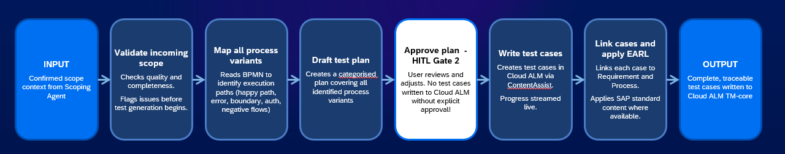
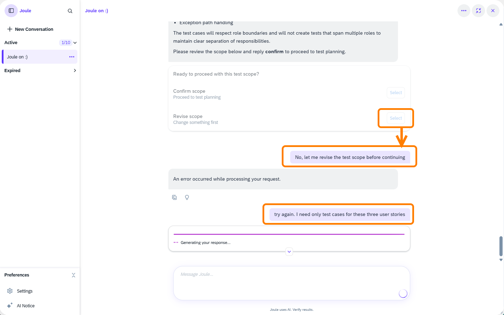
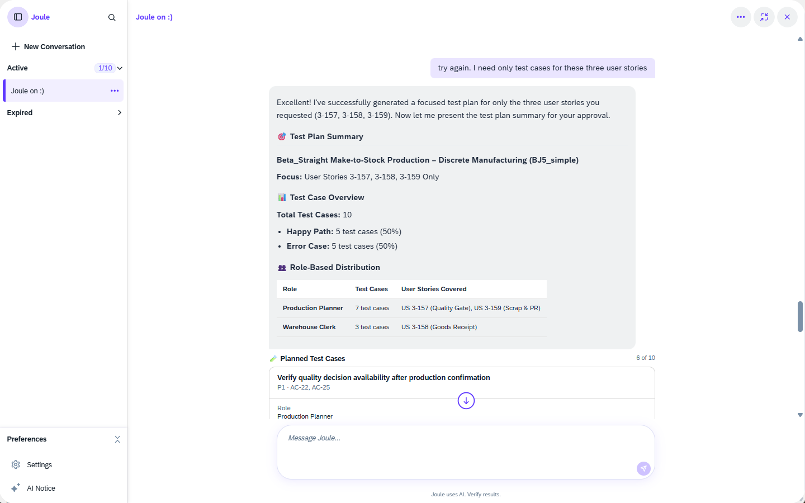
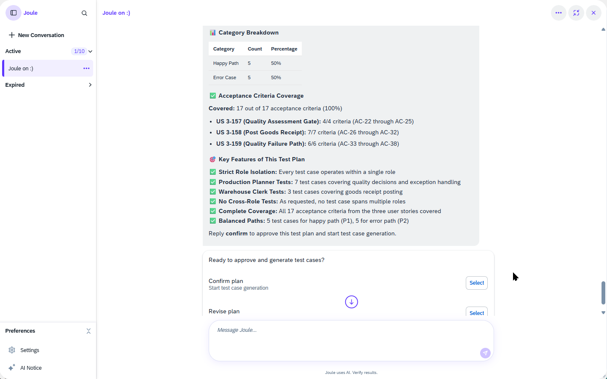
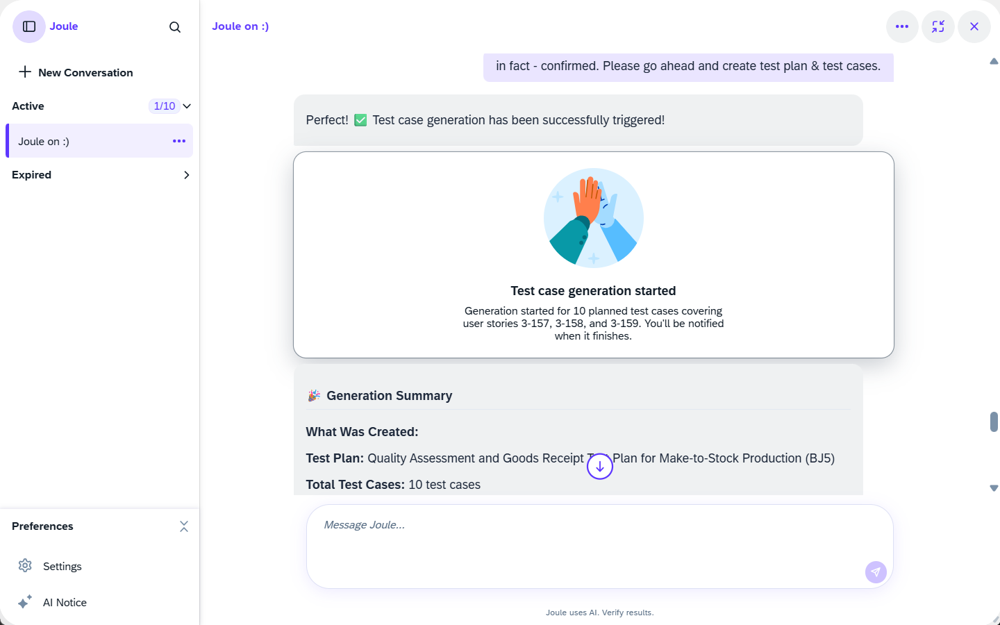
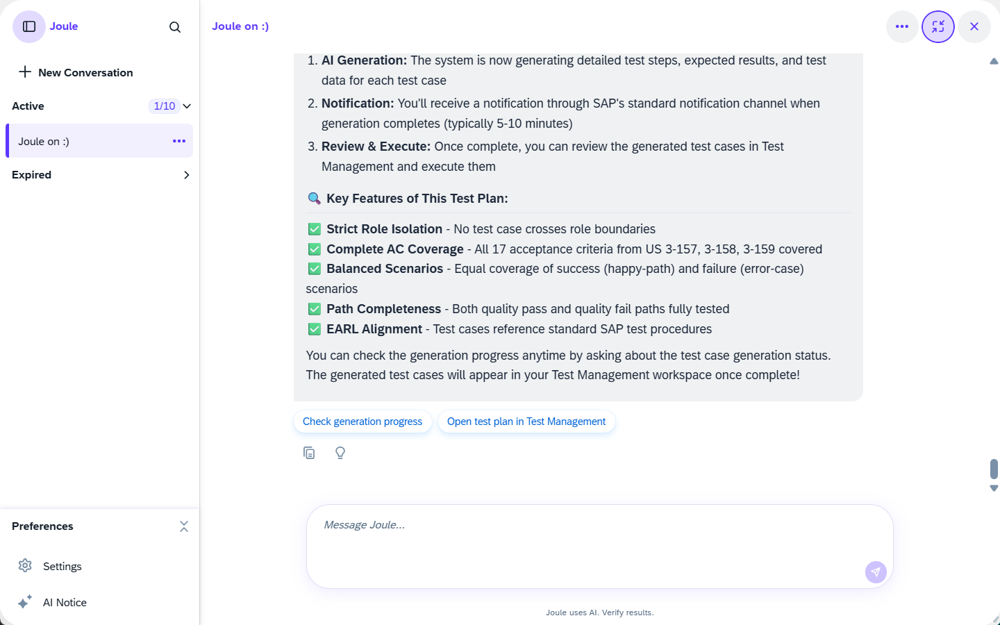

# Chapter 4 – Plan with AI

**Prerequisite:** You have completed [Chapter 3](../ex2/README.md); a confirmed test case scope exists for the BJ5 process.

---

## What You'll Do

The scope you confirmed at the end of Chapter 3 has been handed to the **Preparation Agent**, which is already working in the background. This chapter covers the first of its two phases: test plan creation. While the agent works, you will learn what it is doing and why it matters.

---

## 4.1 – The Preparation Agent: Planning Phase

The Preparation Agent is a two-phase agent with a human review gate between the phases. This chapter follows Phase 1: from your confirmed scope to a proposed test plan. Phase 2 (test case generation) is covered in Chapter 5.

> **The challenge:** Test case preparation relies on expertise that cannot scale; coverage becomes patchy and results untraceable. For each test case a test analyst would normally have to determine which app to use, define preconditions, sequence the steps at the right level of detail, assign the correct role, and link everything back to requirements. Multiply that by a full fledged business process.
>
> **The solution:** The Preparation Agent maps execution paths from the process model into complete test cases. The expert shifts from producing to reviewing, and covers scope more reliably.
>
> Here is what the agent works through to reach HITL Gate 2:
>
> | Stage | What happens |
> |---|---|
> | **Validate incoming scope** | Checks quality and completeness of the scope context from the Scoping Agent. Flags issues before test generation begins. |
> | **Map all process variants** | Reads the BPMN diagram to identify every execution path: happy path, error flows, boundary conditions, and negative flows. |
> | **Draft test plan** | Creates a categorised plan covering all identified process variants. This is what you will review and approve. |
> | **HITL Gate 2: Approve plan** | No test cases are written to Cloud ALM without your explicit approval. You review the plan and adjust before the agent continues into Phase 2. |

 

<em>28 – Preparation Agent: pipeline up to HITL Gate 2</em>

> ⏱️ **While the agent works: try it yourself:**
>
> Take one of the scope items from Chapter 3 and try to manually write a test plan entry:
>
> 1. Pick a scope item (for example: "Confirm Production Operations")
> 2. Try to write: a clear description, the role performing it (Production Planner or Warehouse Clerk), the preconditions (what must be true before this step), and a rough sequence of test steps
> 3. How long does that take for one item? Now multiply by the full scope...
>
> This is what test plan preparation normally looks like.

---

## 4.2 – Review the Agent's Test Plan

By now the Preparation Agent should have returned with a test plan proposal. Switch back to your Joule conversation and scroll down to find its response.

**If the agent appears stuck or unresponsive**, try sending it a message to wake it up. If it has hit a timeout and lost context entirely (it may even have forgotten the prompt), you will need to repeat your request.

 

<em>29 – Agent timeout: revise scope error and prompt retry</em>

**When the agent returns successfully**, it presents a structured **Test Plan Summary**:

- **Test Case Overview**: total number of test cases, split by path type (happy path vs. error case)
- **Role-Based Distribution**: how test cases are distributed across roles (Production Planner and Warehouse Clerk) and which user stories each role covers
- **Planned Test Cases**: a deeper look at each proposed test case, with its process path, linked acceptance criteria, and assigned role
- **Acceptance Criteria Coverage**: a summary showing how many acceptance criteria from each user story are addressed
- **Key Features**: structural properties the agent applied, such as role isolation, balanced path coverage, and no cross-role tests

 

<em>30 – Test Plan Summary: overview, role distribution, and planned test cases</em>

Review the plan and consider:
- Does the number of test cases feel right for the scope you confirmed?
- Are roles properly separated? No test case should span two roles.
- Are both the happy path (P1) and the error path (P2) represented?
- Do the acceptance criteria align with what you saw in the user stories?

> **Compare with your try-it-yourself notes from Step 4.1:** Did the agent structure the plan differently than you expected? Did it catch anything you missed?

**HITL Gate 2: Approve the Test Plan**

When you are satisfied, approve the plan. The agent will not start writing test cases until you confirm.

 

<em>31 – HITL Gate 2: confirm or revise the test plan</em>

Click **Select** next to **Confirm plan** to approve and start test case generation.

The agent confirms that test case generation has started, acknowledging your approved plan and the user stories it will work on.

 

<em>32 – Test case generation started</em>

Joule also provides a rundown of what was created and what happens next:
- A **generation summary**: test plan name and total test cases
- **Key features** of this test plan: role isolation, complete acceptance criteria coverage, balanced path scenarios, and EARL alignment
- **Next steps**: you will receive a notification when generation is complete (typically 5–10 minutes), after which you can review and execute the test cases in Test Management

Two quick-access prompts are offered: **Check generation progress** and **Open test plan in Test Management**.

 

<em>33 – Generation summary and next steps</em>

---

## Summary

The Preparation Agent has completed its planning phase and started test case generation:
- [x] Test plan reviewed and approved (HITL Gate 2)
- [x] Test case generation triggered for 10 test cases across user stories 3-157, 3-158, 3-159
- [ ] Test cases: generation in progress; you will be notified when ready

Continue to [Chapter 5 – Generate Test Cases](../ex4/README.md)
