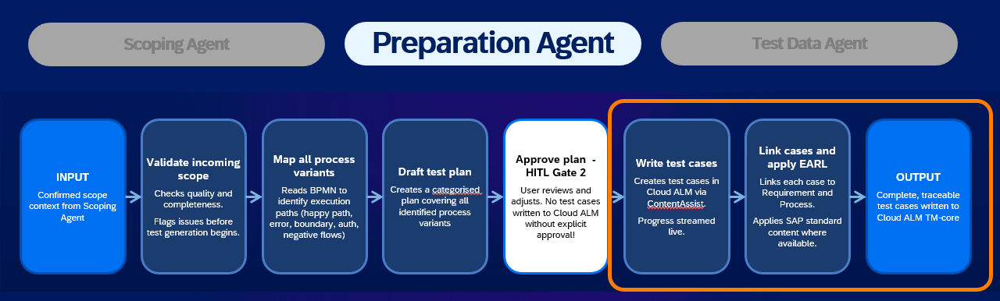
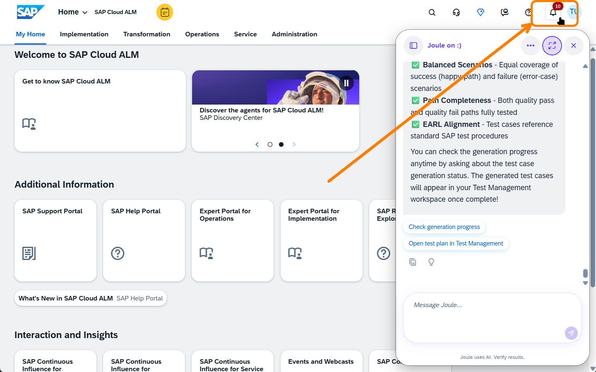
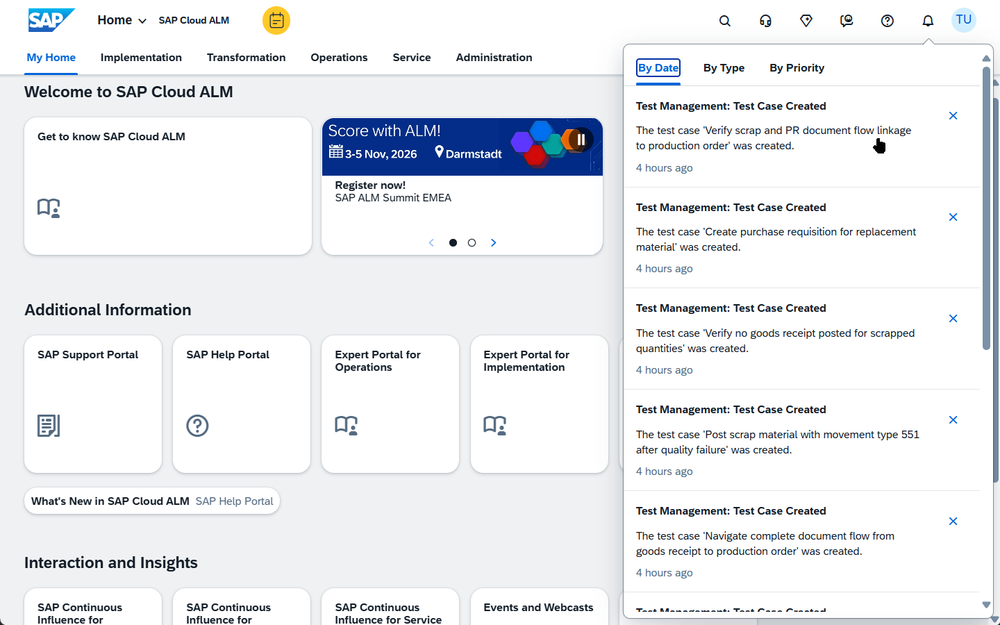
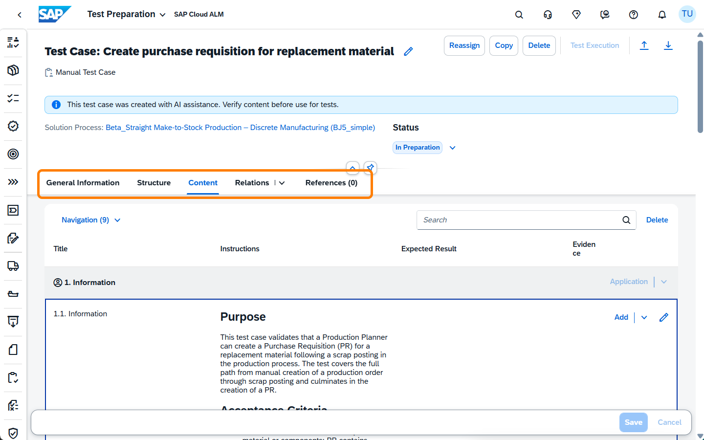

# Chapter 5 – Generate Test Cases

**Prerequisite:** You have completed [Chapter 4](../ex3/README.md); a confirmed test plan exists for the BJ5 process, and test case generation has been triggered and is running in the background.

---

## What You'll Do

In this chapter you'll follow the **Test Case Generation Agent** as it takes the approved test plan and writes detailed, executable test cases. While it works, you'll draft one test case manually to appreciate the effort involved, then compare your result with what the agent produces.

---

## 5.1 – Phase 2: Test Case Generation

The Preparation Agent is now in its second phase. Having cleared HITL Gate 2 with your approved test plan, it is working through the following steps:

- **Write test cases**: For each planned test case, the agent creates a complete entry in SAP Cloud ALM via ContentAssist, including test steps, expected results, preconditions, and role assignments. Progress is streamed live as test cases are written.
- **Link cases and apply EARL**: Each test case is linked to the corresponding Requirement and Solution Process, establishing full traceability. Where available, the agent enriches the content with SAP standard test procedures from the Enterprise Architecture Reference Library (EARL).
- **Output**: Complete, traceable test cases written to Cloud ALM Test Management, ready for review and execution.

 

<em>34 – Preparation Agent Phase 2: test case generation pipeline</em>

> ⏱️ **While the agent works: try it yourself:**
>
> Pick one of the planned test cases and try to write it manually:
>
> 1. Choose a test case from your plan (for example: "Post Goods Receipt for Finished Goods" by the Warehouse Clerk, or "Quality Assessment Gate" by the Production Planner)
> 2. Write a clear description of what is being tested
> 3. Assign the correct role: **Production Planner** or **Warehouse Clerk**
> 4. Write the test steps at the right level of detail (not too high, not too granular)
> 5. For each step, write the expected result
>
> Keep your notes; you'll compare them with the agent's output in Section 5.3.

---

## 5.2 – Manual Test Case Work

While the agent runs, try a more structured breakdown.

For the test case "Post Goods Receipt – Finished Goods" (US-06), fill in this template:

| Element | Your Draft |
|---|---|
| **Test Case Name** | |
| **Role** | Warehouse Clerk |
| **User Story** | BJ5_US-06: Post Goods Receipt – Finished Goods |
| **Precondition** | Production order confirmed; quality assessment passed (Quality OK = Yes, P1 path) |
| **App** | Goods Movements / Post Goods Receipt |
| **Step 1** | Open the Goods Receipt app and select the confirmed production order |
| **Step 1: Expected Result** | |
| **Step 2** | Verify the quantity matches the confirmed production output |
| **Step 2: Expected Result** | |
| **Step 3** | Select movement type and post the goods receipt |
| **Step 3: Expected Result** | |
| **Step 4** | Verify the stock update in the storage location |
| **Step 4: Expected Result** | |
| **Parameters needed** | Production order number, plant, storage location, finished goods material, quantity |

---

## 5.3 – Review the Generated Test Cases

By now the test cases should be ready. Time to see what the agent produced.

**Finding the notifications**

While you were working on your manual test case, the generation agent was completing its work in the background. SAP Cloud ALM sends an in-app notification for each test case created. You will see a badge on the **notifications bell** in the top-right corner of the screen.

 

<em>35 – Notification badge: test cases created</em>

Close the Joule panel first, then click the **notifications bell**. An overlay opens showing one entry per test case, with the test case name and a timestamp.

 

<em>36 – Notification overlay: one entry per generated test case</em>

**Opening and browsing a test case**

Click on any notification to open the test case directly in the SAP Cloud ALM Test Preparation interface. Take a few minutes to browse:

- The **Content** tab: a **Purpose** section describing the business objective, the **Acceptance Criteria** linked from the user story, and the full set of **test steps** with instructions and expected results
- The **General Information** tab: traceability links to the Solution Process and Requirement, and the source indicator: "Manual Test Case – created with AI assistance"
- The **Relations** tab: connection to the scope item and test plan entry
- The **References** tab: any EARL standard content applied

 

<em>37 – Test case detail: Content tab with purpose, acceptance criteria, and test steps</em>

**Quality check**

Review the test case against these criteria:

| Quality Criterion | Check |
|---|---|
| Correct role assigned | ☐ |
| Clear, actionable steps (not too vague, not too granular) | ☐ |
| Expected result for every step | ☐ |
| Input parameters identified | ☐ |
| Traceable to a user story or requirement | ☐ |
| Logical grouping of steps | ☐ |

> **Compare with your manual draft from Step 5.2:** Did the agent's version match what you wrote? What did it do better? What would you change?

**What you have learned**

The agent produced a complete, structured test case, with a business purpose, traceability to acceptance criteria, executable test steps, and expected results, in the time it took you to draft one manually.

Look closely at the test steps: they contain **parameter placeholders**: fields like plant, production order number, or material code that have been identified but not yet filled in with actual system values. Resolving these parameters is the job of the next agent in the pipeline: the **Test Data Management Agent**, covered in Chapter 6.

---

## Summary

The Preparation Agent's Phase 2 wrote detailed, executable test cases for the full BJ5 scope; complete with steps, expected results, and parameter placeholders.

- [x] Test cases generated and reviewed
- [x] Quality criteria checked: role assignment, step clarity, traceability, expected results
- [ ] Test data values: parameter placeholders identified; to be resolved in Chapter 6

Continue to [Chapter 6 – Generate Test Data](../ex5/README.md)
