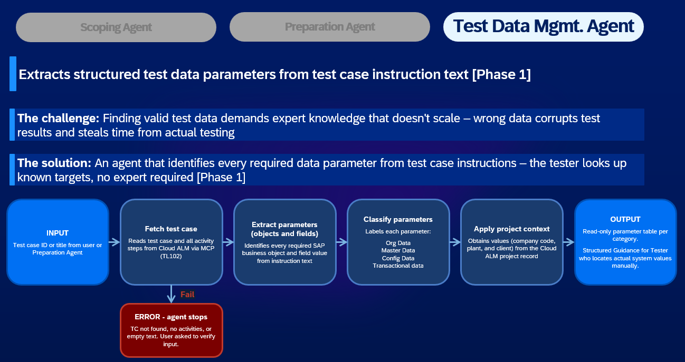
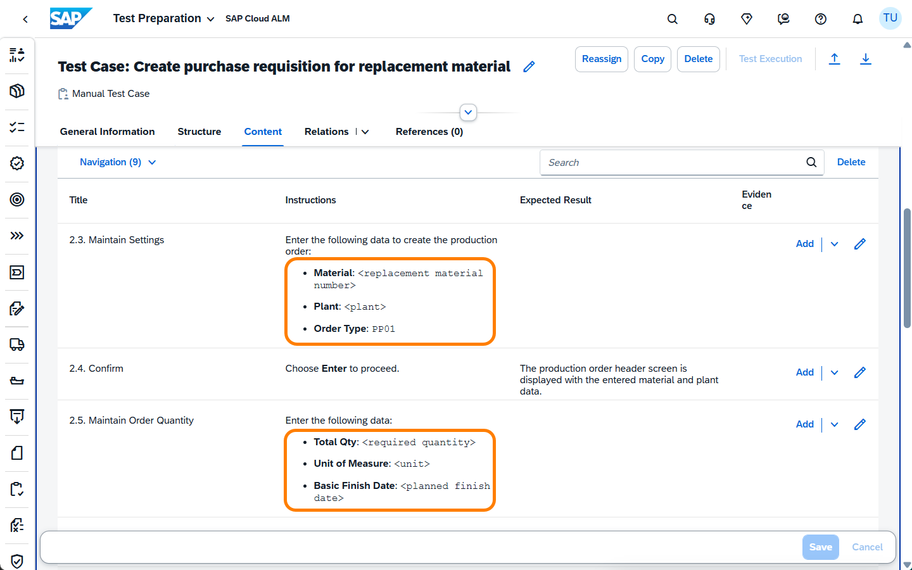
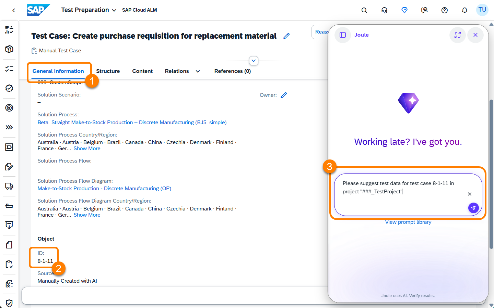
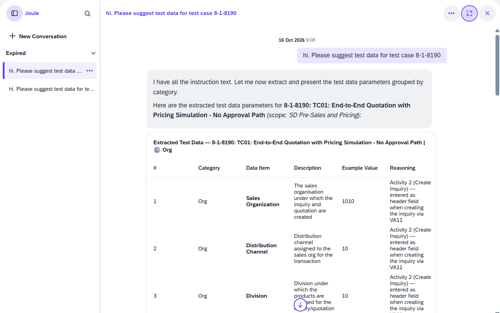

# Chapter 6 – Generate Test Data

Good test data is one of the most underestimated parts of test preparation. A single wrong value (an invalid material, the wrong plant, a date outside the planning horizon) is enough to make a test fail for the wrong reasons, wasting time and masking real defects. Yet gathering valid, consistent test data for a business process like BJ5 traditionally demands expert knowledge of both the process and the system configuration.

**Prerequisite:** You have completed [Chapter 5](../ex4/README.md); test cases have been generated for the BJ5 process and are visible in Test Preparation.

---

## What You'll Do

In this chapter you'll work with the **Test Data Management Agent**. In its current Phase 1 form, the agent reads a test case and extracts every parameter placeholder: the fields where a tester will need a specific system value to execute the step. It classifies them by data category and applies fixed project-level values (company code, plant, client) automatically.

This is the foundation for a longer roadmap: future phases will suggest actual values retrieved from test or productive systems, and eventually write clean test data directly into target systems. For now, Phase 1 turns unstructured test step text into a structured, actionable parameter checklist.

---

## 6.1 – Understanding the Agent

The diagram below shows the full pipeline of the Test Data Management Agent in Phase 1.

 

<em>38 – Test Data Management Agent: Phase 1 pipeline</em>

| Stage | What happens |
|---|---|
| **INPUT** | A test case ID or title, provided by the tester or passed from the Preparation Agent |
| **Fetch test case** | Reads the test case and all its activity steps from SAP Cloud ALM via MCP (TL102). If the test case is not found, has no activities, or the text is empty, the agent stops and asks you to verify the input. |
| **Extract parameters** | Identifies every required SAP business object and field value from the instruction text; every line of "Enter Material…" or "Select Plant…" becomes a structured parameter entry. |
| **Classify parameters** | Labels each parameter by category: **Org Data · Master Data · Config Data · Transactional Data** |
| **Apply project context** | Obtains fixed values (company code, plant, client) from the Cloud ALM project record automatically |
| **OUTPUT** | A read-only parameter table per category; structured guidance for the tester who then locates the actual values in the system |

> **Phase 1 scope note:** The agent identifies and classifies parameters; it does not yet look up or suggest actual system values. The tester uses the output as a structured checklist.

---

## 6.2 – Identify the Parameters in Your Test Case

Before triggering the agent, try it yourself. Open one of your generated test cases in Test Preparation, go to the **Content** tab, and read through the test steps. For each step, note every place where the tester will need to enter a specific value.

Look for patterns like these:

- **Material**: `<replacement material number>`; must exist in the system
- **Plant**: `<plant>`; the plant where the production operation takes place
- **Order Type**: PP01; a configuration value, already fixed here
- **Total Qty**: `<required quantity>`; must be valid for the material and order
- **Basic Finish Date**: `<planned finish date>`; must fall within the planning horizon

For a make-to-stock production and warehousing process like BJ5, you'll typically also encounter:

- **Company code**: fixed from the project configuration
- **Work center**: must exist in the plant and be assigned to the correct cost center
- **Storage location**: must be valid for the plant and movement type
- **Production order number**: a transactional reference that only exists after the order is created
- **Confirmed quantity**: depends on the output of a prior step

Note the distinction: some values are fixed (company code, plant), some are looked up once before the test (material, work center), and some are only generated at runtime (production order number). This is exactly the classification the agent applies.

 

<em>39 – Test case parameters: placeholder values in the instruction text</em>

---

## 6.3 – Trigger the Data Agent

Unlike the previous agents, the Test Data Management Agent does not start automatically after test case generation. This is intentional: test data is a separate output, used alongside test case steps rather than embedded in them. A test case describes *what* to do; test data provides *with what* to do it. These two artefacts have different lifecycles in SAP Cloud ALM, and the decision of when to enrich a test case with data is typically made by the person preparing for execution; in many projects initially a key user, and later the tester directly.

There is also a practical reason: the generated test cases need to be processed and indexed by Cloud ALM before the agent can read them. Starting a fresh Joule conversation ensures a clean context.

**Finding the test case ID**

**1.** Switch to the **General Information** tab of the test case you reviewed in Step 6.2.

**2.** Scroll to the **Object** section at the bottom. Note down the **ID** shown there; it follows the format `8-1-123`.

**Triggering the agent**

**3.** Open a **new Joule conversation** (click the new conversation icon or close and reopen the Joule panel).

**4.** Send this prompt, replacing `###` with your workstation number and inserting the ID from step 2:

> *"Please suggest test data for test case [your test case ID] in project "###_TestProject""*

 

<em>40 – New Joule conversation: triggering the Test Data Management Agent</em>

The agent starts working: it fetches the test case, reads all activity steps, extracts and classifies every parameter, and applies the project context.

---

## 6.4 – Review the Agent's Output

When the agent returns, it presents a structured table of all data parameters identified in the test case, grouped into four categories.

**Organisational data**
The fixed organisational frame: company code, sales organisation, distribution channel, division, and dependent org units such as plant and storage location. These values are typically the same across all test cases in a project and are applied automatically from the project context wherever possible.

**Master data**
Objects that must exist in the system before the test can run: materials valid for the sales area and plant, business partners in the correct role (for example: sold-to party, ship-to, payer), and any dependencies between them. A sold-to party determines which ship-to and payer are valid; a material type determines which item category is auto-assigned.

**Configuration data**
System settings that affect process behaviour: pricing procedures, document types, workflow configurations, authorisation roles. These rarely change between test runs but must be verified to exist and be correctly set up before testing.

**Transactional data**
Values that are either chosen by the tester at runtime or generated on the fly during execution: quantities, dates, and document numbers (order numbers, delivery numbers, production order IDs) that only exist after a preceding step has been completed.

**Why dependencies matter**

The agent does not just list parameters; it explains which values drive which others. This is more valuable than it first appears. Consider a quantity of "10" entered in a production order step: taken in isolation it looks arbitrary. Trace it forward through the process and that same quantity must arrive at a picking step where the storage location needs to hold sufficient stock. If it does not, the test will fail for the wrong reasons: not a defect, but a data setup problem. Understanding these dependencies upfront is the prerequisite for future agent phases to run automated checks and resolve such blocking conditions before a test is even started.

 

<em>41 – Test Data Management Agent output: parameters grouped by category with example values and reasoning</em>

**Evaluate the output**

Compare the agent's parameter table against your manual notes from Step 6.2:

| Quality check | What to look for |
|---|---|
| **Completeness** | Are all parameter placeholders from the test steps in the table? Are there steps where a value is clearly needed but not captured? |
| **Classification** | Are categories assigned correctly? Company code = Org Data; material = Master Data; production order number = Transactional Data |
| **Project context** | Are fixed values like plant and company code already populated from the project record? |
| **Reasoning** | Does the agent trace each parameter back to the test step it came from and explain why it is needed? |
| **Dependencies** | Does the output indicate which parameters drive or constrain others? Use the follow-up prompt below if not. |

> **Compare with your manual notes from Step 6.2:** Did the agent capture everything you identified? Did it find parameters you missed?

At the end of its response, the agent offers suggestions for next steps; one of the most useful is an analysis of the dependencies between the parameter groups. Try sending one of the offered follow-up prompts, or write your own:

> *"Outline the dependencies between the parameters you identified."*

The agent will map which values must be consistent with which others; useful both for manual data lookup and as a foundation for future automated data preparation.

---

## Summary

The Test Data Management Agent turned unstructured test step text into a structured parameter checklist; classifying every placeholder by data category and applying fixed project values automatically.

- [x] Test case parameters extracted and classified by the agent
- [x] Parameter dependencies and categories understood
- [ ] Actual system values: to be looked up by the tester using the agent's output as a checklist

You have now completed the full AI-assisted test preparation cycle:
- [x] Requirements generated from interview transcript (Chapter 2)
- [x] Test scope proposed by Scoping Agent (Chapter 3)
- [x] Test plan structured by Preparation Agent: Phase 1 (Chapter 4)
- [x] Test cases written by Preparation Agent: Phase 2 (Chapter 5)
- [x] Test case parameters identified and classified (Chapter 6)

| Stage | Manual effort (estimate) | AI-assisted |
|---|---|---|
| Requirements from transcript | 2–4 hours (BA) | ~2 minutes + review |
| Test case scoping | 4–8 hours (architect) | ~3 minutes + review |
| Test plan creation | 2–4 hours (test analyst) | ~3 minutes + review |
| Test case writing | 1–2 days (test analyst) | ~5 minutes + review |
| Test data parameters | 2–4 hours (analyst) | ~2 minutes + review |
| **Total** | **3–5 days** | **< 30 minutes** |

Continue to [Chapter 7 – Recap & Outlook](../ex6/README.md)
