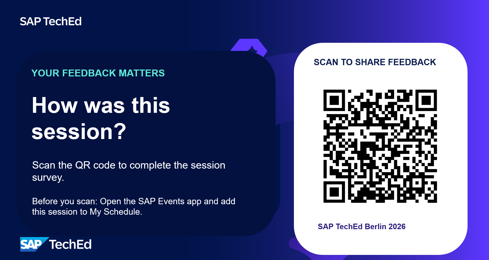

# Chapter 7 – Recap & Outlook

---

## 7.1 – What You Accomplished

You just worked through a complete AI-assisted Test Preparation cycle for a real SAP S/4HANA business process. Here is what you did, and what the agents did alongside you.

| Stage | What you did | What AI contributed |
|---|---|---|
| **Orientation** | Explored the BJ5 process in Cloud ALM; assigned *User Stories*; reviewed the process flow | Joule demonstrated the quality gate: no input, no output |
| **Build input** | Reviewed the interview transcript; connected *Requirement* and *User Stories* to the process | In-built AI feature generated a structured *Requirement* from a raw transcript |
| **Scoping** | Mapped the process manually on paper; evaluated role boundaries and process paths | Scoping Agent analyzed all linked artifacts and produced a traceable test scope in minutes |
| **Test planning** | Drafted a *Test Plan* entry manually for one *Scope Item* | Preparation Agent structured the full scope into a *Test Plan* with roles, paths, and Acceptance Criteria |
| **Test cases** | Wrote one *Test Case* manually in a template | Preparation Agent wrote complete, executable *Test Cases* for the confirmed scope |
| **Test data** | Identified parameter placeholders in a *Test Case* step by step | Test Data Management Agent extracted and classified all parameters, explained dependencies |

What would have taken a test team several days, end to end, was completed by the agents in the time it took you to work through the manual exercises. Not as a replacement for your judgment, but as the first draft you review rather than the blank page you fill.

**The shift:** you moved from *producing* test artifacts to *reviewing* them. The expert role does not disappear; it changes:
Instead of writing Test Steps, you validate whether the agent got the scenario right.
Instead of looking up master data, you confirm whether the classifications make sense.
That judgment is irreplaceable; the mechanical production of structured content is not.

---

## 7.2 – What's Coming Next

The capabilities you worked with today are Phase 1 of the Test Management Assistant in SAP Cloud ALM. The roadmap has three main directions.

**Scoping Agent: broader input sources**

Today the Scoping Agent reads from SAP Cloud ALM. In future waves it will be able to consume additional input types: Jira *Requirements*, Signavio process models, output from other SAP AI assistants in the multi-model architecture (MMA), and more. Scoping will become source-agnostic and will work across the landscape your project actually uses, not just what lives inside Cloud ALM.

**Test Data Management Agent: from identification to execution**

Today the agent identifies and classifies parameters. The next phases extend this into active data management: reading existing data from connected S/4HANA systems, suggesting values from productive data that fit the test context, and eventually writing clean test data directly into test systems before execution. This closes the loop from "what do I need?" to "the data is ready".

**Managing execution of tests: from completed to signed off**

Formal completion and genuine test validation are not the same thing; that gap is invisible in execution statistics and only surfaces at go-live. The next agent aims to close it: monitoring execution quality continuously, verifying that Test Steps were documented rather than clicked through, detecting anomalies such as suspiciously high pass rates relative to known system issues, and evaluating whether reported *Defects* carry enough detail for proper resolution. When the checks pass, it will produce a structured test report and a full *Scope Item* → *Test Case* → result traceability matrix, ready for the Test Manager's approval and sign-off.

---

## 7.3 – Key Takeaways

1. **This is not a separate tool; it binds into Cloud ALM.** Everything generated lives in Cloud ALM Test Management structures: *Test Plans*, *Test Cases* with tabs for content, relations, and references; notifications; traceability links. The agents work within and strengthen the existing SAP Cloud ALM architecture, not alongside it. Your test team's existing workflows, reports, and integrations remain intact.

2. **AI enhances what is already there.** The agents worked because the content was in the system: linked *Requirements*, *User Stories* with Acceptance Criteria, a process model. AI leverages existing structured content; it does not create quality from nothing. Investing in good process documentation and structured *Requirements* pays off twice.

3. **Human judgment is the irreplaceable layer.** Every agent in the pipeline includes a human review gate. The agents produced the first draft; you provided the quality check. Catching a role mismatch, a missing precondition, a *Scope Item* that does not belong: that is the test expert's contribution, and it matters as much as ever.

4. **Traceability is what makes it trustworthy.** The chain runs in two directions at once. Every *Test Case* links to the *Test Plan* and the scope; every *Scope Item* in that scope links to the process, the *User Stories*, and the Acceptance Criteria that defined it. These two structures meet at scope, which means a test result traces all the way back to a specific process path and the acceptance criterion it was designed to prove. When a test passes, you know what passed, what it means for the process, and which criterion it covers. That chain is what allows you to demonstrate testing assurance to auditors, project managers, and stakeholders with confidence.

---

## Questions & Discussion

Some questions to take into the discussion:

1. Where in your current testing process would agents like these save the most time?
2. What inputs do you have today that you would want to feed to a scoping agent? (*Requirements* in Jira? Process models in Signavio? Interview recordings?)
3. At which stage would your team want to review and confirm before the agent continues? Where does the human gate matter most?

---

## Feedback

Please rate this session using the official SAP TechEd survey: open the SAP Events app, add this session to My Schedule, then scan:

 

<em>41 – SAP TechEd session survey</em>

You will also find us after the session if you have further questions or want to share observations directly.

---

## Share Your First Impressions

Help us shape what comes next. Beyond the official session rating, this short survey captures your first impressions: what worked, what surprised you, and where you see the most value. Your responses feed directly into how we prioritise the next development steps for the Test Management Assistant.

If you have ideas or questions that go beyond the survey, find us after the session or leave your contact details in the open question.

10 questions &middot; ~5 min

<a href="https://www.menti.com/alsqqf11whm5" style="color:#0070f2;font-weight:600" target="_blank">menti.com/alsqqf11whm5</a>

<em>42 – Share your first impressions (Mentimeter)</em>

---

## Thank You

Thank you for your time, your curiosity, and your engagement today.

**TM261 – Agent-Led Test Management: Hands-on Lab with Joule in SAP Cloud ALM**

This material remains available after the session at the SAP TechEd GitHub repository.
