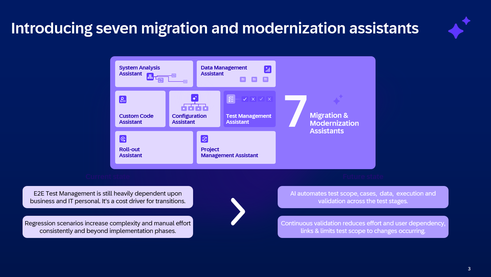
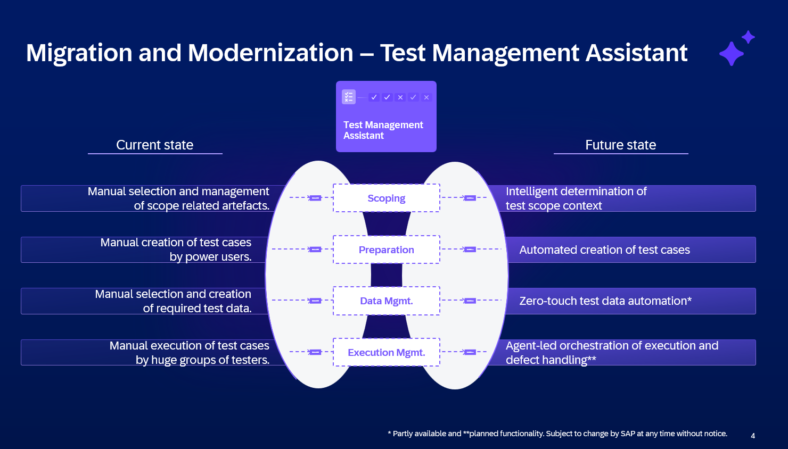

# TM261 – Agent-Led Test Management: Hands-on Lab with Joule in SAP Cloud ALM

**Date:** Thursday, 29 October 2026 · SAP TechEd 2026, Berlin  
**Presenters:** Christina Pickhardt · Niclas Weidner · Tobias Keller · Daniel Lorenz  
**Scenario:** Make-to-Stock Production – Discrete Manufacturing (BJ5)

---

## Agenda

| # | Section | Topic |
|---|---|---|
| – | Introduction | Test Management Assistant: context and agent overview |
| 1 | Getting Started | Log In & Orient Yourself |
| 2 | Generate *Requirements* | Turn an interview transcript into *Requirements* with AI |
| 3 | Scope with AI | Scoping agent; compare with manual scoping |
| 4 | Plan with AI | Planning agent; HITL Gate 2; review |
| 5 | Generate *Test Cases* | TC generation agent; quality review; parameters |
| 6 | Generate Test Data | Data agent; classify & explore; dependencies |
| 7 | Recap & Outlook | Time saved; roadmap; key takeaways |

---

# Introduction: Test Management Assistant

**Context – SAP Migration & Modernization Assistants**

Before we jump into the hands-on, a quick word on context, because what you're about to use is not an isolated feature.

SAP has developed seven AI-powered assistants for Migration and Modernization scenarios, built to help customers move from SAP ECC to S/4HANA Cloud Private Edition faster and with significantly less manual effort:

 

<em>01 – Seven SAP Migration & Modernization Assistants</em>

The **Test Management Assistant** is one of these seven, and Test Management is an area where the shift from manual to AI-driven work matters most:

| Current State | Future State |
|---|---|
| E2E Test Management is still heavily dependent upon business and IT personnel; it's a cost driver for transitions. | AI automates test scope, cases, data, execution and validation across the test stages. |
| Regression scenarios increase complexity and manual effort consistently and beyond implementation phases. | Continuous validation reduces effort and user dependency, links & limits test scope to changes occurring. |

The TMA targets the upstream side of this: the preparation of manual end-to-end testing. It sits at the quality gate of every migration, and as you'll see today, it's where AI can compress days of manual work into minutes of guided review.

## What is the Test Management Assistant?

The Test Management Assistant is not a single AI feature; it's a pipeline of four specialized agents, each transforming a stage of manual Test Preparation into an AI-driven capability:

 

<em>02 – Test Management Assistant: four-agent pipeline</em>

> **Today's hands-on covers the first three agents**: Scoping, Preparation, and Data Management. Execution Management is on the roadmap.
>
> *\* Partly available and \*\*planned functionality. Subject to change by SAP at any time without notice.*

Continue to [Chapter 1 – Getting Started](../ex0/README.md)
